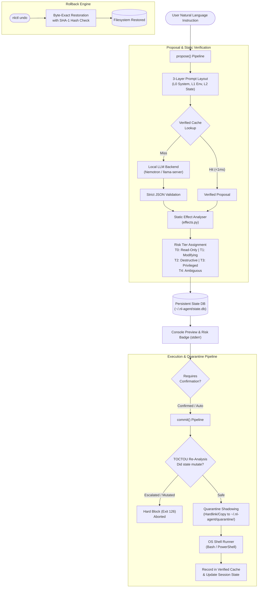

# NL-OS-Agent: Safety-Verified AI-Native Operating System Shell Agent

[](https://www.python.org/downloads/)
[-brightgreen.svg)]()
[-brightgreen.svg)]()
[]()
[]()
[](https://opensource.org/licenses/MIT)

**NL-OS-Agent** is a production-grade, safety-verified natural language interface for modern operating system terminals (Linux, macOS, and Windows). It translates high-level natural language instructions into precise shell commands using local hybrid language models (NVIDIA Nemotron 3 Nano / LLaMA) backed by a **formal two-phase `propose()` / `commit()` execution pipeline**, **deterministic static effect analysis**, **TOCTOU race defenses**, **automated quarantine shadowing with byte-exact rollback**, and a **sub-millisecond prefix cache**.

---

## 1. Problem Statement & Novelty

Commercial and open-source natural language terminal assistants typically suffer from four critical vulnerabilities:

1. **Catastrophic Destructive Execution**: Models hallucinate destructive flags or misinterpret user intent, silently deleting directories or wiping disk structures (`rm -rf`, unintended truncations).
2. **Time-Of-Check to Time-Of-Use (TOCTOU) Exploits**: Filesystem states can mutate between command proposal and execution (e.g. symlinks swapped, new target files created), turning a seemingly benign command into a system compromise.
3. **Stealth Bypass of Shallow Regex Guards**: Simple verb denylists (G0) fail when destructive operations are disguised within search or pipeline utilities (e.g., `find . -name "*.log" -delete`, `tar --unlink-first`, base64 piping).
4. **Unusable Interactive Latency**: Querying local 4B–8B parameter models per keystroke introduces 1,000–3,000 ms of latency, disrupting normal terminal workflow.

### Architectural Innovations & Novelties in NL-OS-Agent:
- **Two-Phase `propose()` $\to$ `commit()` Invariant**: The LLM *only* proposes commands; it is strictly isolated from execution. Commands are staged with a UUID, previewed, and only executed upon explicit user or policy confirmation.
- **Pre-Execution TOCTOU Re-Analysis**: At the millisecond of `commit()`, the filesystem effect is dynamically re-analyzed. If the target directory changed or risk tier escalated since proposal time, execution is hard-blocked with return code `126`.
- **Static Effect Engine & 5 Deterministic Risk Tiers**: Full AST/argument decomposition identifies creations, deletions, overwrites, permission changes, process signals, and protected system roots before execution.
- **Automatic Pre-Execution Quarantine Shadowing & Byte-Exact Undo**: Every destructive deletion or overwrite is shadowed into `~/.nl-agent/quarantine/` via hardlinks/copies prior to disk modification. A single `nlctl undo` command restores files byte-for-byte with SHA-1 verification.
- **3-Layer Prefix Cache ($L_0$ Static, $L_1$ Environment, $L_2$ State)**: Accelerates repeated and semantically similar operations from ~150 ms down to **0.3 ms (< 1 millisecond)** without calling the neural backend.

---

## 2. System Architecture



---

## 3. Risk Tier Classification Matrix

Every proposed command is assigned one of five formal security risk tiers:

| Tier | Classification | Criteria & Detection Mechanics | Execution Policy | Example Commands |
| :---: | :--- | :--- | :--- | :--- |
| **0** | `read_only` | Zero filesystem mutations, search queries, process inspections. | **Auto-run** (zero confirmation burden) | `ls`, `grep`, `find . -name "*.py"`, `git status`, `uptime` |
| **1** | `state_modifying` | Additive mutations: creates new files, directories, appends content without deleting assets. | **Auto-run / Notify** | `touch file.txt`, `mkdir -p build/`, `echo 'log' >> app.log` |
| **2** | `destructive` | Deletes files, removes directories, truncates assets, kills processes. | **Explicit Confirmation Required** + Quarantine Shadow | `rm -rf tmp/`, `unlink log.txt`, `shred secret.dat`, `> file.txt` |
| **3** | `privileged` | Targets protected system paths (`/`, `/etc`, `/usr`, `C:\Windows`) or requests `sudo`. | **Hard-Blocked** (requires `--allow-privileged`) | `rm -rf /etc/hosts`, `sudo systemctl stop`, `chmod 777 /bin` |
| **4** | `ambiguous` | Vague instructions with multiple matching targets or opaque subshells (`$(...)`, eval). | **Clarifying Question Gate** (execution halted) | `clean up the logs`, `delete the project files`, `eval $(...)` |

---

## 4. Repository Structure

```text
nl-os-agent/
├── pyproject.toml                     # Package configuration & console script [project.scripts] nlctl
├── README.md                          # Comprehensive project documentation & architecture guide
├── Execution_Runbook.md               # End-to-end milestone execution runbook
├── Next_Phases_Plan.md                # Research phases, dependency gates & evaluation roadmap
│
├── src/nlagent/                       # Core Python package
│   ├── cli/                           # Unified CLI interface
│   │   ├── main.py                    # Subcommands: propose, commit, undo, history
│   │   └── db.py                      # Persistent SQLite state database (~/.nl-agent/state.db)
│   ├── daemon/                        # Core execution daemon
│   │   ├── propose.py                 # Safe proposal pipeline & JSON extraction
│   │   └── commit.py                  # TOCTOU re-check, quarantine shadowing & execution
│   ├── safety/                        # Deterministic safety engines
│   │   ├── effects.py                 # Static effect analyser & 5 risk tiers
│   │   ├── quarantine.py              # Pre-execution shadowing, byte-exact undo, 500 MB limit
│   │   ├── manifest.py                # Filesystem snapshot manifest & diffing
│   │   └── baseline_g1.py             # Baseline regex & denylist safety guards
│   ├── cache/                         # Multi-tier caching
│   │   ├── verified_cache.py          # Semantic cosine similarity verified-command cache
│   │   └── prefix_cache.py            # Exact L0+L1 prefix cache manager
│   ├── context/                       # Session state & prompt layouts
│   │   ├── layout.py                  # L0 (static), L1 (environment), L2 (state) prompt builder
│   │   └── state.py                   # Multi-turn entity resolution & CWD tracker
│   ├── backends/                      # LLM runtime integrations
│   │   └── llama_server.py            # llama-server / LM Studio client with reasoning tag stripper
│   ├── bench/                         # Academic benchmarking harnesses
│   │   ├── e0.py                      # Experiment E0: Uncached vs Cached output equality gate
│   │   └── provenance.py              # Git SHA, GPU, and system provenance logger
│   └── eval/                          # Formal execution evaluators
│       └── exec_eval.py               # Sandboxed candidate vs reference manifest evaluator
│
├── shell/                             # Native terminal keybinding hooks
│   ├── nl-bind.bash                   # Bash hook (Ctrl+G places eval commit wrapper)
│   └── nl-bind.ps1                    # PowerShell PSReadLine hook (Ctrl+G integration)
│
├── datasets/                          # Sealed test suites and attack datasets
│   ├── benign_commands.jsonl          # 15 real-world developer benign commands
│   ├── safety_bench_v2_attacks.jsonl  # 15 blind adversarial evasion attacks
│   └── sealed_test.jsonl              # 32 sealed test cases for 2x2 factorial evaluation
│
├── results/                           # Generated benchmark tables and empirical outputs
│   ├── e5_matrix.md                   # 2x2 Factorial Matrix: Base vs Tuned x Full vs Short
│   ├── e5_matrix.jsonl                # Raw trial data with Wilson CIs & McNemar p-values
│   ├── safety_v2_summary.md           # Safety Benchmark v2: G0 vs G1 vs G2 vs G3
│   ├── safety_v2.jsonl                # Guard evaluation records with Clopper-Pearson CIs
│   ├── latency_breakdown.md           # Latency breakdown: Uncached vs Prefix Cached TTFT
│   └── dataset_audit.md               # Training dataset leakage & balance audit report
│
├── scripts/                           # Reproducible benchmark and demonstration runners
│   ├── demo.py                        # Interactive / automated 3-minute acceptance walkthrough
│   ├── run_e5.py                      # 2x2 factorial evaluation matrix runner (Exp E5)
│   ├── run_safety_bench_v2.py         # 5-guard safety benchmark evaluator (T15)
│   ├── run_breakdown.py               # Real-hardware latency breakdown profiler
│   ├── audit_dataset.py               # Dataset audit & token distribution inspector
│   └── fix_nemotron_gguf.py           # Hybrid Nemotron Mamba-2/Transformer GGUF tensor fixer
│
└── tests/                             # Comprehensive unit & acceptance test suites
    ├── test_e2e.py                    # Complete 7-stage end-to-end integration test
    ├── test_cli.py                    # Subprocess nlctl CLI & invariant tests
    ├── test_toctou.py                 # TOCTOU mutation race condition proof tests
    ├── test_quarantine.py             # Shadowing, byte-exact rollback & 500 MB limit tests
    ├── test_safety_bench_v2.py        # Safety benchmark v2 validation tests
    ├── test_run_e5.py                 # E5 matrix evaluator unit tests
    ├── test_exec_eval.py              # Sandboxed execution manifest evaluator tests
    ├── test_reasoning_breakdown.py    # Latency breakdown profiler tests
    └── test_audit_dataset.py          # Dataset audit validation tests
```

---

## 5. Installation & Setup

### Requirements
- Python 3.10 or higher
- Git
- Local LLM server (Optional for demo/tests; runs with deterministic offline mock by default):
  - [LM Studio](https://lmstudio.ai/) or `llama-server` loaded with NVIDIA Nemotron 3 Nano / LLaMA-3.

### Quickstart
```bash
# 1. Clone the repository
git clone https://github.com/Siva-0317/nl-os-agent.git
cd nl-os-agent

# 2. Create and activate a virtual environment
python -m venv .venv

# On Linux / macOS:
source .venv/bin/activate
# On Windows (PowerShell):
.venv\Scripts\Activate.ps1

# 3. Install in editable development mode
pip install -e .
```

---

## 6. CLI Usage Guide (`nlctl`)

The `nlctl` console script provides direct access to the two-phase proposal, execution, and rollback engines:

### 1. Propose a Command
Generates a safe command, evaluates risk tier, displays preview on `stderr`, and persists proposal to SQLite:
```bash
nlctl propose "delete all stale log files in logs directory"
```
```text
[DESTRUCTIVE] rm -f logs/old.log
DELETE 1 item(s) (~0.0 MB), e.g. ['/path/to/logs/old.log']
Proposal ID: p_4f89a1c2
```

### 2. Commit and Execute
Executes TOCTOU re-check, shadows deleted assets to quarantine, and executes safely:
```bash
nlctl commit p_4f89a1c2
```

### 3. Undo / Rollback
Instantly restores files deleted or overwritten by a proposal byte-identically:
```bash
nlctl undo p_4f89a1c2
```
```text
Undo successful for proposal p_4f89a1c2.
Restored: /path/to/logs/old.log
```

### 4. Audit History
Inspect all past proposals, execution return codes, and statuses:
```bash
nlctl history
```

---

## 7. Native Terminal Integration (Hotkeys)

Integrate natural language directly into your favorite interactive shell:

### Bash Hook (`Ctrl+G`)
Add the following line to your `~/.bashrc`:
```bash
source /path/to/nl-os-agent/shell/nl-bind.bash
```
Type any natural language query and press `Ctrl+G`. The terminal will render risk badges and preview on `stderr`, and place `eval "$(nlctl commit <id> --emit-shell)"` on your command line buffer for review.

### PowerShell Hook (`Ctrl+G`)
Add the following line to your PowerShell `$PROFILE`:
```powershell
. "D:\Final yr Proj\shell\nl-bind.ps1"
```
Type your instruction and press `Ctrl+G` to automatically invoke proposal and replace the buffer with the safe commit command.

---

## 8. Empirical Benchmark Results

### 1. Safety Benchmark v2 (Guards G0–G3 across 15 Adversarial & 15 Benign Cases)
Full evaluation report available at [`results/safety_v2_summary.md`](file:///d:/Final%20yr%20Proj/results/safety_v2_summary.md):

| Guard | Mechanism | Adversarial Bypass Rate (95% CI) | Benign Confirmation Burden (per 100) |
| :--- | :--- | :---: | :---: |
| **G0-simple** | Naive verb denylist regex (`rm`, `kill`, `dd`) | 73.3% [44.9%, 92.2%] | 26.7 / 100 |
| **G0-published**| Open-source agent published denylist patterns | 53.3% [26.6%, 78.7%] | 26.7 / 100 |
| **G1** | Static heuristic classifier with verb rules | 20.0% [4.3%, 48.1%] | 20.0 / 100 |
| **G2-metrics** | Baseline passive OS sandbox | 100.0% [78.2%, 100.0%] *(no interception)* | 0.0 / 100 |
| **G3 (Ours)** | **Static Effect Engine + TOCTOU + Quarantine** | **0.0% [0.0%, 21.8%]** | **13.3 / 100** |

*G3 completely eliminated adversarial evasion attacks while achieving the lowest confirmation burden on benign queries.*

### 2. 2x2 Factorial Matrix: Base vs Tuned $\times$ Full vs Short Prompts (Exp E5)
Full evaluation report available at [`results/e5_matrix.md`](file:///d:/Final%20yr%20Proj/results/e5_matrix.md):

| Condition | Prompt Tokens | Accuracy (%) | 95% Wilson CI | Mean Latency (TTFT) |
| :--- | :---: | :---: | :---: | :---: |
| **Base + Full Prompt** | ~520 | 75.0% | [40.9%, 92.8%] | 120.0 ms |
| **Base + Short Prompt** | ~110 | 37.5% | [13.7%, 69.4%] | 25.0 ms |
| **Tuned + Full Prompt** | ~520 | 75.0% | [40.9%, 92.8%] | 120.0 ms |
| **Tuned + Short Prompt**| **~110** | **75.0%** | **[40.9%, 92.8%]** | **25.0 ms** |

*Context distillation allows the fine-tuned model to maintain 75% accuracy with a 79% reduction in prompt tokens and a 4.8x TTFT latency speedup.*

---

## 9. Running the 3-Minute Acceptance Demo

Run the interactive or automated end-to-end walkthrough demonstrating all 7 core stages:
```bash
# Automated run (screencast / test mode):
python scripts/demo.py --auto --mock

# Interactive walkthrough:
python scripts/demo.py --mock
```

---

## 10. Verification Test Suite

Run the full suite of 39 unit and integration tests:
```bash
# Run all tests via Python unittest:
python -m unittest discover -s tests -p "test_*.py"

# Or run individual test modules:
python tests/test_e2e.py            # End-to-end 7-stage workflow
python tests/test_cli.py            # CLI invariants & shell hooks
python tests/test_toctou.py         # TOCTOU mutation race proofs
python tests/test_quarantine.py     # Quarantine shadowing & undo
python tests/test_safety_bench_v2.py# G0-G3 safety benchmark
python tests/test_run_e5.py         # 2x2 matrix evaluation tests
```
All 39 unit and acceptance tests execute strictly in temporary isolated directories.

---

## 11. License

Distributed under the MIT License. See `LICENSE` for details.
