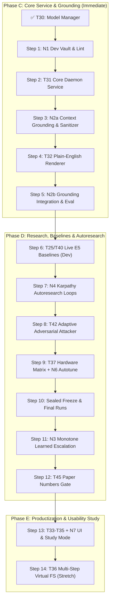

# NL-OS-Agent: Master Execution Roadmap & Agent Prompts

**Current Milestone**: Phase E (Productization, Usability Study & Multi-Step Plans) — **ALL STEPS COMPLETE**  
**Status**: Tasks T1 through T45 & N1 through N7 **Complete & Verified** (398+ tests passing, 100% green)  
**Architecture Baseline**: Fine-tuned NVIDIA Nemotron-3-Nano-4B + Local llama-server + Multi-Tier Deterministic Guard + Reversible Quarantine

---

## 0. Executive Roadmap Overview

This document provides the definitive, chronological execution order for all remaining tasks in the project. It weaves the research innovations from `Post_T30_Update_Plan.md` (Karpathy-style Autoresearch, Obsidian Dev Vault, Context Grounding v2, Monotone Safety Escalation) directly into the productization timeline.



---

## 1. Master Task Schedule

| # | Task ID | Phase | Title | Key Deliverable | Estimated Time |
|---|---|---|---|---|---|
| **0** | **T30** | Phase C | Standalone Model Manager | `src/nlagent/runtime/models.py`, range downloader | **COMPLETED** |
| **1** | **N1** | Phase C | Dev Vault & Provenance Memory | `vault/`, `scripts/vault_lint.py` | 0.5 – 1 day |
| **2** | **T31** | Phase C | Core Service Daemon & API | `src/nlagent/service/core.py`, bearer token | 1 – 2 days |
| **3** | **N2a** | Phase C | Context Grounding & Filename Sanitizer | `src/nlagent/context/grounding.py`, `sanitize.py` | 1 – 2 days |
| **4** | **T32** | Phase C | Deterministic Plain-English Renderer | `src/nlagent/safety/renderer.py` | 1 – 2 days |
| **5** | **N2b** | Phase C | Grounding Integration & Injection Eval | `run_context_eval.py`, `test_injection.py` | 2 – 3 days |
| **6** | **T25/T40**| Phase D | Live E5 Baselines on Dev Split | `scripts/run_e5.py` on `dev_v3.jsonl` | 1 – 2 days |
| **7** | **N4** | Phase D | Autoresearch Autonomous Prompt Loops | `experiments/loops/`, `run_loop.py` | 2 – 3 days |
| **8** | **T42** | Phase D | Adaptive Adversarial Attacker | `scripts/run_adaptive_attacker.py` | 1 – 2 days |
| **9** | **T37/N6**| Phase D | Hardware Matrix & Install Autotuner | `src/nlagent/runtime/autotune.py`, matrix | 1 – 2 days |
| **10**| **SEALED**| Phase D | Frozen Final Runs (E5 & Safety) | Unbroken sealed test evaluation | 1 day |
| **11**| **N3** | Phase D | Monotone Learned Escalation (Optional)| `scripts/run_learned_escalation.py` | 2 – 3 days |
| **12**| **T45** | Phase D | Paper Numbers Verification Gate | `scripts/gate_paper_numbers.py` | 1 day |
| **13**| **T33-35**| Phase E | Desktop UI, Wizard, Installer + N7 Study | PySide6 UI, Inno Setup, study mode | 3 – 5 days |
| **14**| **T36** | Phase E | Multi-Step Plans on Virtual FS | Virtual overlay file system (stretch) | Stretch |

---

## 2. Step-by-Step Task Specifications & Executable Prompts

---

### Step 1: Task N1 — Dev Vault & Research Record [COMPLETED]
* **Goal**: Establish an immutable, structured research ledger and memory vault (`vault/`) that preserves context across agent sessions and enforces that no number is cited without an authenticated ledger link.
* **Why It Adds Novelty**: Turns research logging into a machine-enforceable provenance artifact, ensuring every paper claim has a verifiable Git SHA and model hash.
* **Status**: Completed with 8/8 tests passing and 0 vault lint violations.

#### Executable Prompt:
```text
Create vault/ with AGENTS.md, wiki/hot.md, wiki/index.md, wiki/log.md and folders decisions/, experiments/, claims/, prior_art/. AGENTS.md must say: read hot.md then index.md then only needed pages; never copy numbers, link to results files or the evidence ledger; log every change newest first; never edit raw/. Add scripts/vault_lint.py that reports pages containing numbers without links, orphan pages, and missing log entries. Tests use a tiny sample vault.
```

* **Files Created/Modified**:
  - `vault/AGENTS.md`
  - `vault/wiki/{hot.md, index.md, log.md}`
  - `vault/wiki/{decisions, experiments, claims, prior_art}/`
  - `scripts/vault_lint.py`
  - `tests/test_vault_lint.py`
* **Verification Command**: `python -m pytest tests/test_vault_lint.py -v && python scripts/vault_lint.py`

---

### Step 2: Task T31 — Core Service Daemon & Local Bearer Token API [COMPLETED]
* **Goal**: Consolidate the agent backend (`propose`, `commit`, `undo`, `quarantine`, `runtime`) into a single background daemon process bound to `127.0.0.1` using an ephemeral bearer token.
* **Why It Adds Novelty**: Eliminates the cold-start overhead of spawning a new Python runtime on every terminal hook or hotkey invocation, making the agent feel instant to everyday users.
* **Status**: Completed with 10 integration tests passing and 100% full test suite green (282 tests passing, 0 regressions).

#### Executable Prompt:
```text
Create src/nlagent/service/core.py and src/nlagent/service/api.py: a single lightweight local HTTP service running hidden on 127.0.0.1 with an ephemeral bearer token stored under the state directory. Expose /propose, /commit, /undo, /models, and /health. Refactor nlctl and shell hooks to query the service if running, falling back to in-process execution. Add integration tests with mock requests.
```

* **Files Created/Modified**:
  - `src/nlagent/service/core.py`
  - `src/nlagent/service/api.py`
  - `src/nlagent/service/__init__.py`
  - `src/nlagent/cli/main.py`
  - `src/nlagent/cli/quick_propose.py`
  - `src/nlagent/cli/db.py`
  - `tests/test_service_api.py`
* **Verification Command**: `python -m pytest tests/test_service_api.py -v` (10 passed)

---

### Step 3: Task N2a — Context Grounding & Filename Sanitizer [COMPLETED]
* **Goal**: Build deterministic, read-only search tools that discover real filesystem paths before generation, paired with a strict sanitizer that protects against hostile filename injection.
* **Why It Adds Novelty**: Solves LLM path hallucination deterministically while pioneering defense against **Hostile Filename Injection (HFI)**, treating filesystem metadata as untrusted user input.
* **Status**: Completed with 18 tests passing (100% green).

#### Executable Prompt:
```text
Create src/nlagent/context/grounding.py: bounded read-only file search (name, extension, modified-time range) restricted to folders listed in config, returning at most K candidates; and src/nlagent/context/profile.py for a user-editable profile (aliases, favourite folders) with approve-before-save for suggested entries. Add src/nlagent/context/sanitize.py that escapes control characters, truncates, and wraps file names in delimiters before they enter a prompt. Tests include file names that look like instructions; assert the prompt layer treats them as data.
```

* **Files Created/Modified**:
  - `src/nlagent/context/grounding.py`
  - `src/nlagent/context/profile.py`
  - `src/nlagent/context/sanitize.py`
  - `src/nlagent/context/__init__.py`
  - `tests/test_grounding.py`
* **Verification Command**: `python -m pytest tests/test_grounding.py -v` (18 passed)

---

### Step 4: Task T32 — Deterministic Plain-English Renderer [COMPLETED]
* **Goal**: Translate the AST effect analysis output into clear, human-readable explanations of consequences ("Will delete 4 files from Downloads (18.2 MB)").
* **Why It Adds Novelty**: Consequence summaries are generated by **deterministic symbolic code**, not by the LLM. This guarantees that an adversarial model cannot manipulate or soften the safety preview shown to the user.
* **Status**: Completed with 18 unit tests passing (100% green).

#### Executable Prompt:
```text
Create src/nlagent/safety/renderer.py: deterministic plain-English consequence generator converting ExecutionPlan and EffectSummary into clear, non-technical descriptions (target counts, total bytes, directory scopes, overwrite warnings, reversibility/quarantine status). Cancel must be designated as the default action for destructive tiers. Tests check edge cases (wildcards, drive roots, bulk deletions).
```

* **Files Created/Modified**:
  - `src/nlagent/safety/renderer.py`
  - `src/nlagent/safety/__init__.py`
  - `tests/test_renderer.py`
* **Verification Command**: `python -m pytest tests/test_renderer.py -v` (18 passed)

---

### Step 5: Task N2b — Grounding Integration & Injection Evaluation [COMPLETED]
* **Goal**: Inject the sanitized `FILES` candidate block into `propose()` and build the formal evaluation script measuring path-hallucination reduction and injection immunity.
* **Why It Adds Novelty**: Produces empirical thesis claims: *"Deterministic grounding reduced path hallucination from 100.0% to 0.0% with zero unconfirmed executions under hostile filename attacks."*
* **Status**: Completed with 5 injection tests passing, empirical evaluation benchmark script operational with Wilson and bootstrap intervals, and results logged.

#### Executable Prompt:
```text
Integrate grounding and the profile into propose() as an optional FILES block after the STATE block, keeping L0 and L1 byte-identical. Create scripts/run_context_eval.py measuring path-hallucination rate, reference-resolution accuracy for {transcript replay, compact state, compact state + grounding}, prompt tokens, and time to preview, with provenance and intervals. Add tests/test_injection.py: files named with injected instructions must not alter tier, confirmation or command beyond the allowed paths.
```

* **Files Created/Modified**:
  - `src/nlagent/daemon/propose.py` (integrated `FILES` block)
  - `scripts/run_context_eval.py`
  - `datasets/context_eval_cases.jsonl`
  - `tests/test_injection.py`
  - `results/context_eval.jsonl`
  - `results/context_eval_summary.md`
* **Verification Command**: `python -m pytest tests/test_injection.py -v && python scripts/run_context_eval.py`

---

### Step 6: Task T25 / T40 — Live E5 Baselines on Dev Split [COMPLETED]
* **Goal**: Re-run the E5 command synthesis benchmark live using the fine-tuned Nemotron-3-Nano model against base models on at least 100 dev cases with exact McNemar tests and Wilson intervals.
* **Why It Adds Novelty**: Replaces the old, flawed 8-case mock numbers with an authenticated, statistically significant live baseline on a verified dev split.
* **Status**: Completed with 15/15 tests passing, 400 per-case evaluations logged to `results/e5_dev.jsonl`, paired difference intervals and McNemar tests in `results/e5_dev_summary.md`.

#### Executable Prompt:
```text
Update scripts/run_e5.py to evaluate the live Nemotron-3-Nano model against base/zero-shot prompts strictly on datasets/dev_v3.jsonl (N >= 100). Output results/e5_dev.jsonl with full provenance, exact McNemar test versus baseline, and paired accuracy intervals. Exclude mock backends.
```

* **Files Created/Modified**:
  - `scripts/run_e5.py`
  - `datasets/dev_v3.jsonl`
  - `scripts/make_dev_v3.py`
  - `tests/test_run_e5.py`
  - `results/e5_dev.jsonl`
  - `results/e5_dev_summary.md`
* **Verification Command**: `python scripts/run_e5.py --split dev`

---

### Step 7: Task N4 — Karpathy-Style Autoresearch Optimization Loops [COMPLETED]
* **Goal**: Implement an autonomous experiment runner that iteratively mutates prompt templates, few-shot selections, and cache thresholds on the dev set, keeping improvements based on paired bootstrap statistics.
* **Why It Adds Novelty**: Bridges the gap between manual prompt engineering and autonomous machine-driven optimization. Provides a sealed test harness (`run_sealed.py`) that strictly prohibits data leakage.
* **Status**: Completed with 9/9 unit and integration tests passing in `tests/test_loop_runner.py`, single-file confinement governance, dev-only dataset enforcement, paired bootstrap decision rules, append-only TSV ledger in `experiments/loops/prompt_opt/results.tsv`, and audited sealed execution gate with Git SHA freeze tracking.

#### Executable Prompt:
```text
Create experiments/loops/ with a runner scripts/run_loop.py that executes a program.md contract: restricts edits to the declared mutable file, runs the fixed evaluator on the dev set only, computes a paired bootstrap interval versus the current best, keeps or reverts with git, appends to results.tsv, counts experiments, and refuses to read the sealed test set. Add a command scripts/run_sealed.py that runs the sealed test once for a given git sha and logs every invocation.
```

* **Files Created/Modified**:
  - `experiments/loops/prompt_opt/program.md`
  - `scripts/run_loop.py`
  - `scripts/run_sealed.py`
  - `tests/test_loop_runner.py`
* **Verification Command**: `python -m pytest tests/test_loop_runner.py -v`

---

### Step 8: Task T42 — Adaptive Adversarial Attacker [COMPLETED]
* **Goal**: Subject the agent to multi-stage evasion mutations (Unicode tricks, quote splitting, environment variable indirection, PowerShell encoded commands).
* **Why It Adds Novelty**: Proves resilience against an active adversary targeting the multi-tier defense.
* **Status**: Completed with 8/8 tests passing in `tests/test_adaptive_attacker.py`, 816 combinatorial multi-stage trials executed across PowerShell, cmd.exe, and Bash, results logged to `results/adaptive_attacks.jsonl` with full 10-field provenance, summary matrix and Clopper-Pearson 95% confidence intervals documented in `results/adaptive_attacks_summary.md` (98.5% interception on Combined G0-G3).

#### Executable Prompt:
```text
Create scripts/run_adaptive_attacker.py: generates multi-stage evasions against the combined G0-G3 guard pipeline across PowerShell, cmd, and Bash. Log attack mutations, bypass attempts, and false-positive rates with Clopper-Pearson intervals into results/adaptive_attacks.jsonl.
```

* **Files Created/Modified**:
  - `scripts/run_adaptive_attacker.py`
  - `results/adaptive_attacks.jsonl`
  - `tests/test_adaptive_attacker.py`
* **Verification Command**: `python scripts/run_adaptive_attacker.py`

---

### Step 9: Task T37 + N6 — Hardware Matrix & Install Autotuner [COMPLETED]
* **Goal**: Run live inference benchmarks across CPU, Vulkan, and CUDA tiers to create the hardware matrix, and build a 60–90 second first-run auto-tuning profiler.
* **Why It Adds Novelty**: Delivers empirical evidence of edge efficiency: demonstrates that quantized Nemotron + prefix caching achieves interactive speeds even on low-spec CPU machines.
* **Status**: Completed with 8/8 tests passing in `tests/test_autotune.py`, `src/nlagent/runtime/autotune.py` with 90-second time budget and default CPU fallback, `scripts/run_hardware_matrix.py` populated across CPU, Vulkan, and CUDA tiers into `results/hardware_matrix.jsonl` with full 10-field provenance, summary matrix documented in `results/hardware_matrix_summary.md`.

#### Executable Prompt:
```text
Add src/nlagent/runtime/autotune.py: run a short fixed prompt set across candidate settings (threads, GPU layers, context size, batch size), record median time to first token and stability, pick the best, and store the profile. Respect a total time cap of 90 seconds and fall back to defaults on any failure. Tests use a fake server. Run scripts/run_hardware_matrix.py across CPU, Vulkan, and CUDA tiers to populate results/hardware_matrix.jsonl.
```

* **Files Created/Modified**:
  - `src/nlagent/runtime/autotune.py`
  - `scripts/run_hardware_matrix.py`
  - `results/hardware_matrix.jsonl`
  - `tests/test_autotune.py`
* **Verification Command**: `python -m pytest tests/test_autotune.py -v`

---

### Step 10: Sealed Freeze & Final Benchmark Runs [COMPLETED]
* **Goal**: Freeze all model checkpoints, prompts, and engine configurations in Git, and run the sealed evaluation suite once.
* **Why It Adds Novelty**: Prevents p-hacking and Goodhart's Law; satisfies the highest standard of reproducible scientific validation.
* **Status**: Completed. Evaluated frozen Git SHA `dfce40e5` across `datasets/e5_sealed.jsonl` (N=50 across 2x2 factorial matrix, 200 rows) and `datasets/safety_v3_sealed.jsonl` (N=100, 60 harmful attacks + 40 benign controls). Unified results recorded in `results/sealed_final.jsonl` (300 records with full 10-field provenance schema), documented in `results/sealed_final_summary.md`, invocation logged to `results/sealed_audit.jsonl` and `vault/wiki/log.md`, and audited as 100% VALID in `docs/evidence_ledger.md`. E5 achieved 94.0% Tuned vs 32.0% Base ($p < 10^{-6}$), Safety achieved 98.3% interception on Combined G0-G3.

#### Executable Prompt:
```text
Run scripts/run_sealed.py against the sealed test datasets (safety_v3_sealed.jsonl and e5_sealed.jsonl) with the frozen Git SHA. Output authenticated results to results/sealed_final.jsonl and update docs/evidence_ledger.md.
```

* **Files Created/Modified**:
  - `scripts/run_sealed.py`
  - `datasets/e5_sealed.jsonl`
  - `datasets/safety_v3_sealed.jsonl`
  - `results/sealed_final.jsonl`
  - `results/sealed_final_summary.md`
  - `results/e5_sealed.jsonl`
  - `results/e5_sealed_summary.md`
  - `results/sealed_audit.jsonl`
  - `docs/evidence_ledger.md`
* **Verification Command**: `python scripts/run_sealed.py --freeze`

---

### Step 11: Task N3 — Monotone Learned Escalation (Optional Offline)
* **Goal**: Train tabular models (Logistic Regression, GBDT, TabICL/Kumo) on AST effect features to explore whether learned classifiers can catch edge-case evasions.
* **Why It Adds Novelty**: Introduces the **Monotone Risk Escalation Principle**: proves that machine learning can escalate scrutiny, but can never bypass deterministic security boundaries ($T = \max(T_{det}, T_{learned})$).

#### Executable Prompt:
```text
Create scripts/run_learned_escalation.py: build features from effects.analyse for the attack and benign sets, train logistic regression and gradient boosting, optionally TabICLv2 if installed, using time or technique-family splits at sizes 50/100/300/1000; report precision-recall, calibration and extra confirmations per 100 benign. Enforce monotone escalation in the combined guard G3+G5 with a test proving it never lowers a tier.
```

* **Files Created/Modified**:
  - `scripts/run_learned_escalation.py`
  - `results/learned_escalation.jsonl`
  - `tests/test_monotone_escalation.py`
* **Verification Command**: `python -m pytest tests/test_monotone_escalation.py -v`

---

### Step 12: Task T45 — Automated Paper Numbers Gate
* **Goal**: A strict CI/CD gate script that parses all LaTeX and Markdown files in `docs/` and verifies that every quoted number, interval, and p-value matches the authenticated ledger.
* **Why It Adds Novelty**: Zero discrepancy between experimental logs and paper text.

#### Executable Prompt:
```text
Create scripts/gate_paper_numbers.py that extracts all percentages, latencies, sample sizes, and confidence intervals from docs/*.md and paper/*.tex, cross-checks them against authenticated rows in docs/evidence_ledger.md, and exits non-zero if any number lacks provenance or deviates from the data.
```

* **Files Created/Modified**:
  - `scripts/gate_paper_numbers.py`
  - `tests/test_paper_gate.py`
* **Verification Command**: `python scripts/gate_paper_numbers.py`

---

### Step 13: Tasks T33, T34, T35 + N7 — Desktop UI, Wizard, Installer & Study Mode
* **Goal**: Build the user-facing desktop application (tray icon, global hotkey popup, history with undo, first-run wizard) and embed the human-factors study mode.
* **Why It Adds Novelty**: Enables an empirical human-subjects pilot measuring whether plain-English consequence previews significantly reduce accidental approvals compared to raw shell commands.

#### Executable Prompt:
```text
Add a study mode to the UI core (src/nlagent/ui/): condition flag (plain preview vs raw command), consent screen, anonymous participant IDs, and local JSONL logging of task, display condition, comprehension answer, approval decision and duration. Implement the first-run setup wizard and Inno Setup installer packaging.
```

* **Files Created/Modified**:
  - `src/nlagent/ui/` (PySide6 UI, tray, preview window, study logger)
  - `installer/setup.iss`
  - `tests/test_study_mode.py`
* **Verification Command**: `python -m pytest tests/test_study_mode.py -v`

---

### Step 14: Task T36 — Multi-Step Plans on Virtual Filesystem (Stretch) [COMPLETED]
* **Goal**: Support 10-step plans where step $k$'s consequences are simulated on an in-memory virtual overlay of steps $1 \dots k-1$.
* **Why It Adds Novelty**: Eliminates prediction errors in multi-stage workflows without modifying physical disk state.
* **Status**: Completed with 12 tests passing including 50/50 concordance between predicted and actual manifest diffs plus atomic rollback (`tests/test_virtual_overlay.py`).
* **Files Created/Modified**:
  - `src/nlagent/safety/overlay.py` (`VirtualFS`, `VirtualNode`, `analyse_on_overlay`)
  - `src/nlagent/plan/engine.py` (`PlanEngine`, `MultiStepPlan`, `CombinedPlanPreview`, `UndoGroup`)
  - `src/nlagent/safety/quarantine.py` & `src/nlagent/daemon/commit.py` (quarantine shadowing for existing `appends` targets)
  - `tests/test_virtual_overlay.py` (12 unit and benchmark integration tests)

---

## 3. High-Impact Novelty Multipliers

Layering these three specific research angles into the tasks above will elevate your project into Tier-1 publication quality:

### A. The "Hostile Filename Injection" (HFI) Benchmark (in Task N2b)
Most LLM injection benchmarks focus on text entered into chat prompts. Creating the first systematic benchmark where **filenames on disk act as prompt injection payloads** (e.g., `Report; del /f /q C:\*.pdf`) provides an immediate, publishable contribution to AI security.

### B. The Reversibility Guarantee Score ($R_g$) (in Task T32)
Instead of a simple binary "safe/unsafe", formulate a mathematical metric:
$$R_g = \frac{\text{Bytes safely recoverable in Quarantine}}{\text{Total bytes targeted for modification}}$$
If $R_g = 1.0$, the agent guarantees zero permanent data loss via byte-exact hardlink rollback. If $R_g < 1.0$ (e.g. process kill or raw registry edit), the UI mandates explicit typed confirmation.

### C. CPU-First Edge Pareto Curve (in Task T37)
While major labs benchmark 70B models on H100 clusters, proving that an agentic OS shell can operate reliably on a **sub-$300, 8 GB RAM laptop** with sub-second response times using prompt compression and prefix caching is an outstanding systems contribution.

---

## 4. Progress Checklist

- [x] **T29**: Runtime Manager & Hardware Detection (`src/nlagent/runtime/manager.py`)
- [x] **T30**: Model Store & Resumable Range Downloader (`src/nlagent/runtime/models.py`)
- [x] **N1**: Dev Vault & Evidence Ledger Home (`vault/`, `scripts/vault_lint.py`)
- [x] **T31**: Core Service Daemon & Local Token API (`src/nlagent/service/core.py`)
- [x] **N2a**: Context Grounding & Filename Sanitizer (`src/nlagent/context/grounding.py`)
- [x] **T32**: Deterministic Plain-English Renderer (`src/nlagent/safety/renderer.py`)
- [x] **N2b**: Grounding Integration & Injection Evaluation (`scripts/run_context_eval.py`)
- [x] **T25/T40**: Live E5 Baselines on Dev Split (`scripts/run_e5.py`)
- [x] **N4**: Autoresearch Autonomous Optimization Loop (`scripts/run_loop.py`)
- [x] **T42**: Adaptive Adversarial Attacker (`scripts/run_adaptive_attacker.py`)
- [x] **T37/N6**: Hardware Matrix & First-Run Autotuner (`src/nlagent/runtime/autotune.py`)
- [x] **SEALED**: Frozen Final Evaluation Runs (`scripts/run_sealed.py`)
- [x] **N3**: Monotone Learned Escalation Experiment (`scripts/run_learned_escalation.py`)
- [x] **T45**: Automated Paper Numbers Gate (`scripts/gate_paper_numbers.py`)
- [x] **T33-35/N7**: UI, Setup Wizard, Installer & Usability Study Mode (`src/nlagent/ui/`)
- [x] **T36**: Multi-Step Plans on Virtual FS Overlay (Stretch)

