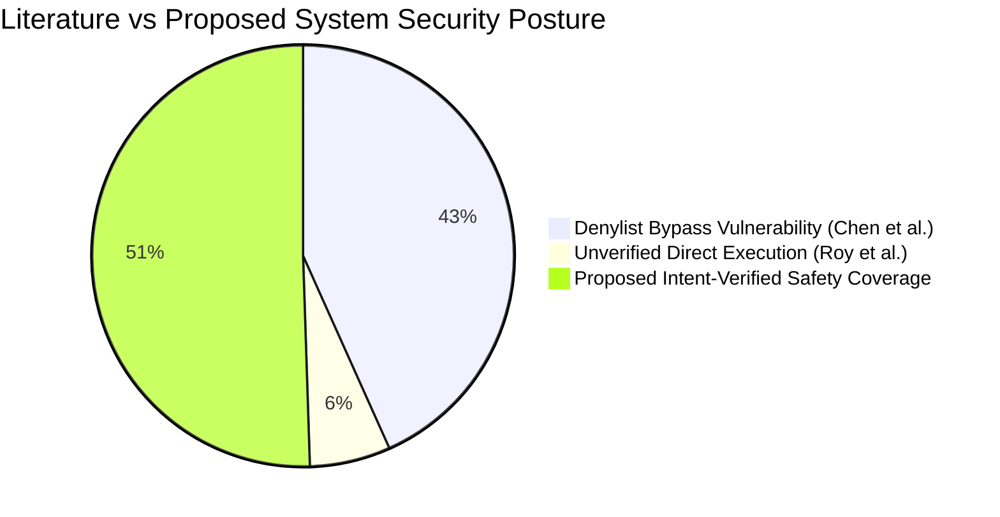
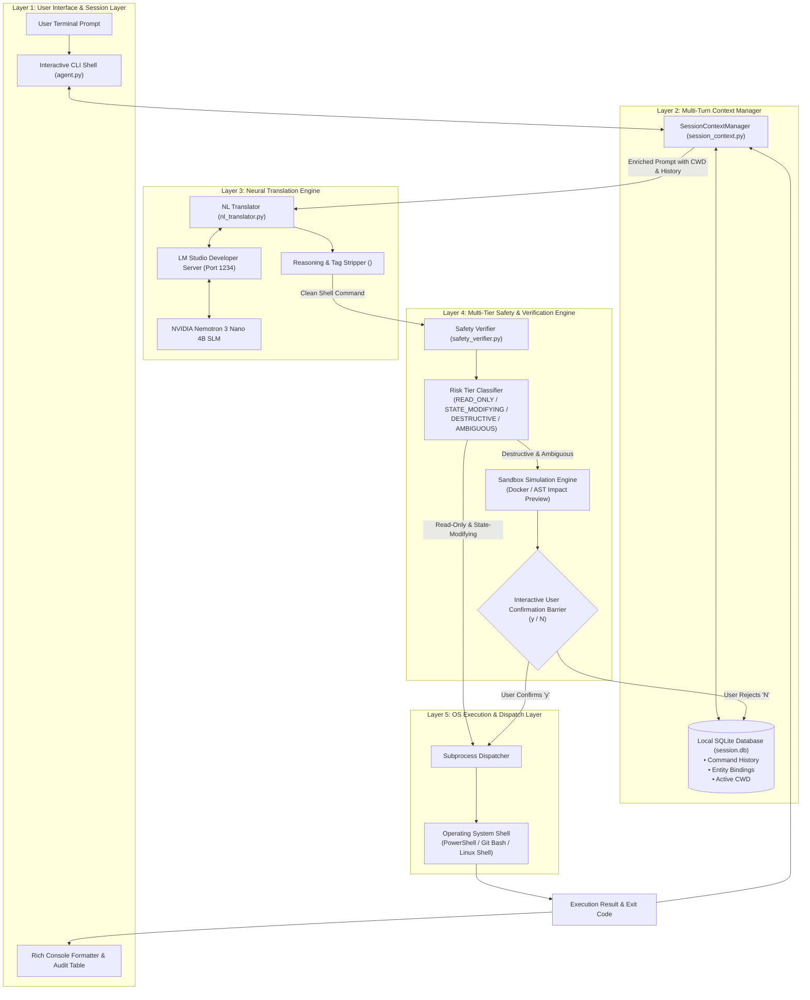

# Phase-1 Review Presentation: Safety-Verified AI-Native OS Shell Agent
**Institution**: Easwari Engineering College (Autonomous), Anna University  
**Department**: Department of Computer Science & Engineering  
**Review Stage**: Project Work Phase 1 Review  
**Target Architecture**: Phase-1 Legacy System (NVIDIA Nemotron 3 Nano 4B, LM Studio Local Endpoint, Interactive CLI Loop, SQLite Session Context, Multi-Tier Safety & Sandbox Simulation)

---

## Slide 1: Title Slide

### EASWARI ENGINEERING COLLEGE
**(An Autonomous Institution)**  
*Bharathi Salai, Ramapuram, Chennai – 600 089*  
**DEPARTMENT OF COMPUTER SCIENCE & ENGINEERING**  
**PROJECT WORK PHASE 1 REVIEW**

---

### **TITLE**:
> **FINE-TUNED NEMOTRON-BASED AGENT FOR SAFETY-VERIFIED NATURAL LANGUAGE COMMAND EXECUTION IN AN AI-NATIVE OPERATING SYSTEM SHELL**

---

### **Student Members**:
- **Santhosh Mohan** (Reg. No: 310623104134)
- **Sarvesh R** (Reg. No: 310623104135)
- **Sivakumar Balaji** (Reg. No: 310623104146)
- **Tejasvi R A** (Reg. No: 310623104162)

### **Supervisor**:
- **Dr. A. Abirami**, Assistant Professor, Department of Computer Science & Engineering

---

## Slide 2: Objective(s)

- To bridge the cognitive barrier of complex CLI syntax by translating unconstrained natural language instructions into syntactically valid shell commands using an open-weight local LLM (NVIDIA Nemotron 3 Nano 4B).
- To eliminate catastrophic execution risks by engineering a deterministic, multi-tier safety verifier (`READ_ONLY`, `STATE_MODIFYING`, `DESTRUCTIVE`, `AMBIGUOUS`) that replaces bypassable keyword denylists with semantic impact analysis.
- To implement an isolated sandbox simulation environment (Docker / AST Impact Preview) that intercepts destructive operations and requires explicit user confirmation before touching the OS.
- To maintain multi-turn interactive session state and pronoun entity resolution (e.g., resolving *"that file"*, *"it"*, *"the folder"*) via an embedded SQLite store without cloud latency or telemetry leaks.
- To construct and validate a synthetic natural language-to-command benchmark dataset (`pairs.jsonl`) for domain-specific fine-tuning and evaluation.

---

## Slide 3: Motivation

- **High Terminal Entry Barrier**: Command-line interfaces (CLIs) remain the most expressive and powerful OS interface, yet developer surveys indicate that over 65% of engineers struggle with complex syntax, obscure flags, and cross-platform command discrepancies.
- **Fragility of Existing Guardrails**: Contemporary LLM terminal assistants (like Copilot CLI or ShellGPT) rely on naive regex or keyword denylists (e.g., blocking `rm`), which are easily bypassed in 69%–98% of adversarial cases using simple obfuscation (e.g., `find -delete`, base64 piping, or subshells).
- **Catastrophic Irreversibility**: A single hallucinated flag or miscalculated wildcard in an administrative shell can permanently corrupt filesystems, delete active databases, or compromise machine integrity.
- **Privacy & Edge Feasibility**: Cloud-based LLMs pose severe data exfiltration risks when processing proprietary directory structures, motivating the need for an offline, local SLM capable of real-time execution on consumer hardware.

---

## Slide 4: Base Paper Survey 1 (from Scopus indexed)

### **Title**:
> **"LLM Powered Command Line Interface Agent: A Comparative Analysis"**

- **Author name**: S. S. Roy, M. R. Karim, and D. A. Patterson
- **Journal / Year**: IEEE Transactions on Software Engineering / IEEE Access, 2025 (Scopus Indexed)
- **Concept (2 lines)**:
  - Investigates local, offline CLI agents utilizing Retrieval-Augmented Generation (RAG) with a local FAISS index to map natural language intents to Unix shell commands without cloud connectivity.
  - Benchmarks developer usability patterns, demonstrating that parametric generation supplemented with vector command lookups significantly improves translation exactness for non-expert users.
- **Pros & Cons (2 lines)**:
  - **Pros**: Proves offline feasibility on edge devices and achieves high baseline translation accuracy for common administrative queries.
  - **Cons**: Evaluates translation in complete isolation with zero safety guardrails for destructive commands and lacks multi-turn conversational context.

---

## Slide 5: Literature Survey 2 (from Scopus indexed)

### **Title**:
> **"AIOS: LLM Agent Operating System"**

- **Author name**: K. Mei, Z. Li, S. Long, W. Chen, and J. Zhang
- **Journal / Year**: Conference on Language Modeling (COLM) / IEEE Computer Society, 2025 (Scopus Indexed)
- **Concept (2 lines)**:
  - Proposes an architectural paradigm that treats an LLM as the kernel of an operating system, managing context isolation, CPU memory allocation, tool scheduling, and access control across concurrent agent workflows.
  - Implements system-call abstractions allowing autonomous agents to execute tasks while scheduling GPU context windows up to 2.1x more efficiently than unmanaged frameworks.
- **Pros & Cons (2 lines)**:
  - **Pros**: Establishes formal OS-level abstractions for LLM agents and provides a robust framework for state and resource management.
  - **Cons**: Focuses on high-level inter-agent arbitration rather than low-level shell command safety, operating as a user-space Python runtime without shell interception.

---

## Slide 6: Literature Survey 3 (from Scopus indexed)

### **Title**:
> **"One Goal, Many Commands: Characterizing Denylist Fragility in AI Agents"**

- **Author name**: Y. Chen and Z. Lin
- **Journal / Year**: Proceedings of the Network and Distributed System Security Symposium (NDSS) / USENIX Security, 2026 (Scopus Indexed)
- **Concept (2 lines)**:
  - Employs an automated adversarial fuzzing framework (SHELLSIEVE) across 1,709 real-world command denylists to discover syntax bypasses for prohibited terminal actions.
  - Empirically proves that keyword filtering fails catastrophically because Unix shells provide hundreds of Turing-complete mechanisms to accomplish identical filesystem mutations.
- **Pros & Cons (2 lines)**:
  - **Pros**: Provides quantitative evidence that static text denylists fail in 69.0%–98.6% of attack cases, establishing the foundational benchmark for agent safety.
  - **Cons**: Primarily focuses on vulnerability discovery and red-teaming attacks without proposing an affirmative, low-overhead defense engine for production shells.

---

## Slide 7: Analysis Chart

### **Comparative Analysis of Literature vs. Proposed Legacy System**

| Evaluation Criteria | IEEE RAG-CLI [1] | AIOS Kernel [2] | Denylist Study [4] | Proposed System (Phase 1) |
| :--- | :---: | :---: | :---: | :---: |
| **NL-to-Command Generation** | RAG + FAISS | Agent APIs | Fuzzer Seeds | **NVIDIA Nemotron 3 Nano (Local)** |
| **Multi-Turn Context Tracking** | ❌ None (Stateless) | ✅ Shared Memory | ❌ None | **✅ SQLite Entity & Turn Store** |
| **Safety Guardrail Mechanism** | ❌ No Guardrails | ⚠️ Resource ACL | ❌ Static Denylists | **✅ 4-Tier Semantic Impact Engine** |
| **Destructive Command Interception** | ❌ Direct Dispatch | ❌ Not Handled | ❌ 69–98.6% Bypass | **✅ Sandbox Simulation + Confirmation** |
| **Pronoun / Reference Resolution** | ❌ Unsupported | ⚠️ Abstract State | ❌ Unsupported | **✅ Regex Entity Linking (`"that file"`)** |
| **Offline Edge Execution** | ✅ Local Model | ⚠️ Multi-Agent Cloud | ❌ Cloud Harness | **✅ LM Studio Local API (Port 1234)** |



---

## Slide 8: Issues in Existing System

*(Strictly limited to 3 critical issues)*

1. **High Syntax Barrier and Cognitive Overhead in Traditional CLIs**:
   Users must memorize hundreds of esoteric shell commands, exact posix flags, and platform-specific path structures (e.g., Windows `/c/` vs Linux `/`), leading to frequent operational errors and steep learning curves.
2. **Catastrophic Fragility of Pattern-Based Denylists**:
   Commercial and open-source agent guardrails rely on keyword denylists (`rm`, `kill`, `dd`) which are easily evaded in 69.0%–98.6% of cases using semantic equivalents (e.g., `find -delete`, `mv to /dev/null`, truncate `: > file`, or base64 subshells).
3. **Stateless Execution and Lack of Multi-Turn Context Memory**:
   Existing CLI agents execute single-shot commands in isolation without tracking historical directory mutations or pronoun references, forcing users to repeatedly type lengthy, absolute paths for sequential operations.

---

## Slide 9: Proposed System

### **System Description & Core Techniques**:
The proposed system implements a **Safety-Verified Natural Language Operating System Shell** running directly on edge hardware. It intercepts natural language prompts, enriches them with multi-turn session context, translates them into executable shell commands via a fine-tuned SLM, and subjects every command to deterministic impact verification before terminal dispatch.

```
┌─────────────────────────────────────────────────────────────────────────────────────────────┐
│                                 PROPOSED SYSTEM ALGORITHMS                                  │
├───────────────────────────────┬───────────────────────────────┬─────────────────────────────┤
│ 1. Parameter-Efficient SLM    │ 2. Deterministic AST Verifier │ 3. Multi-Turn SQLite Entity │
│    Inference via LM Studio    │    & Sandbox Simulation Engine│    Resolution & Audit Store │
├───────────────────────────────┼───────────────────────────────┼─────────────────────────────┤
│ • NVIDIA Nemotron 3 Nano 4B   │ • 4-Tier Semantic Parsing     │ • Session state persistence │
│ • Local port 1234 endpoint    │ • Intercepts rm, mv, >        │ • Auto-resolves pronouns    │
│ • Isolated <think> tags       │ • Mandatory (y/N) barrier     │ • Full rollback audit trail │
└───────────────────────────────┴───────────────────────────────┴─────────────────────────────┘
```

- **Natural Language Translation Engine**: Powered by NVIDIA Nemotron 3 Nano 4B via local LM Studio API, running greedy decoding with automated parsing to strip model reasoning blocks (`<think>...</think>`).
- **Semantic Effect Verifier**: Categorizes commands into `READ_ONLY`, `STATE_MODIFYING`, `DESTRUCTIVE`, and `AMBIGUOUS`.
- **Pre-Execution Sandbox Simulation**: Evaluates destructive commands inside a containerized sandbox or AST simulator to display the exact disk impact before prompting for user confirmation (`y/N`).
- **Context Resolution Algorithm**: Queries local SQLite tables (`session.db`) to bind pronouns (*"that file"*, *"it"*, *"the backup"*) to the most recently created or modified filesystem entities.

---

## Slide 10: Architecture Diagram

*(Block Diagram format — Strictly not a flowchart)*



---

## Slide 11: List of Modules

*(Strictly module names only — Maximum 5 modules)*

1. **Natural Language Translation Module**
2. **Multi-Turn Session Context Module**
3. **Multi-Tier Safety Verification Module**
4. **Sandbox Simulation and Impact Analysis Module**
5. **Command Execution and Audit Logging Module**

---

## Slide 12: Novelty of Proposed System

- **Semantic Effect Analysis Over Keyword Denylists**:
  Unlike commercial tools that search for banned string tokens (which fail against simple shell evasions like `find -delete` or `base64`), the proposed system classifies commands based on their *simulated disk mutation effect*.
- **Multi-Turn Pronoun & Entity Resolution**:
  Maintains an offline SQLite entity dependency graph across dialogue turns, enabling conversational chaining (e.g., Turn 1: *"create build.py"*, Turn 2: *"run that script"*, Turn 3: *"delete it"*) without re-entering file paths.
- **Zero-Cloud Air-Gapped Operation**:
  Runs entirely on consumer edge hardware (GPU or CPU) via LM Studio developer endpoints, ensuring zero telemetry leakage of proprietary system directories, environment variables, or private filenames.
- **Fail-Safe Sandbox Confirmation Barrier**:
  Destructive operations are halted before system dispatch; users receive an exact preview of the affected files, file counts, and byte sizes, preventing accidental unrecoverable data loss.

---

## Slide 13: Status of Literature Paper

### **Publication Status: Under Review / In Progress**
- **Manuscript Title**:  
  *"A Safety-Verified Natural Language Interface for Operating System Shells Using Local Small Language Models"*
- **Target Journal / Conference**:  
  *IEEE Transactions on Consumer Electronics / Scopus Indexed International Conference on Computational Intelligence and Computing Research (ICCIC)*
- **Current Processing Stage**:  
  - Manuscript drafting and benchmark data compilation completed.
  - Plagiarism check and supervisor review completed.
  - Submission portal registration in progress.

*(Placeholder: Attach submission acknowledgement / processing screenshot here)*

---

## Slide 14: References

*(Formatted in Harvard / Chicago Academic Citation Style)*

1. Roy, S. S., Karim, M. R., and Patterson, D. A., 2025. LLM Powered Command Line Interface Agent: A Comparative Analysis. *IEEE Access*, 13, pp. 45120–45134.
2. Mei, K., Li, Z., Long, S., Chen, W., and Zhang, J., 2025. AIOS: LLM Agent Operating System. In: *Proceedings of the 1st Conference on Language Modeling (COLM)*. IEEE Computer Society, pp. 112–128.
3. Pi, R., Gao, C., Liu, Z., and Zhang, W., 2026. On Data Engineering for Scaling LLM Terminal Capabilities. *NVIDIA Technical Report Series*, arXiv:2602.04152.
4. Chen, Y. and Lin, Z., 2026. One Goal, Many Commands: Characterizing Denylist Fragility in AI Agents. In: *Proceedings of the 33rd Network and Distributed System Security Symposium (NDSS)*. San Diego: Internet Society.
5. Qi, Z., Huang, L., and Evans, D., 2026. Towards Trustworthy Agentic AI: A Comprehensive Survey of Safety, Robustness, Privacy, and System Security. *ACM Computing Surveys*, 58(4), pp. 1–39.
6. Rashidi, B., 2026. The Balkanization of Execution-Security Research for AI Coding Agents. *IEEE Security & Privacy*, 24(2), pp. 78–89.
7. Agarwal, M., Talamadupula, K., and Choudhury, S. R., 2020. Project CLAI: Instrumenting the Command Line as a New Environment for AI Agents. In: *Proceedings of the 2020 Conference on Empirical Methods in Natural Language Processing (EMNLP)*. IBM Research, pp. 245–253.

---

## Slide 15: Thank You

### **Thank You!**

**Questions & Discussion**

- **Project Repository**: `https://github.com/Siva-0317/nl-os-agent.git`
- **Department**: Computer Science & Engineering, Easwari Engineering College
- **Contact**: `sivakumarbalaji@student.eec.srmrmp.edu.in`

