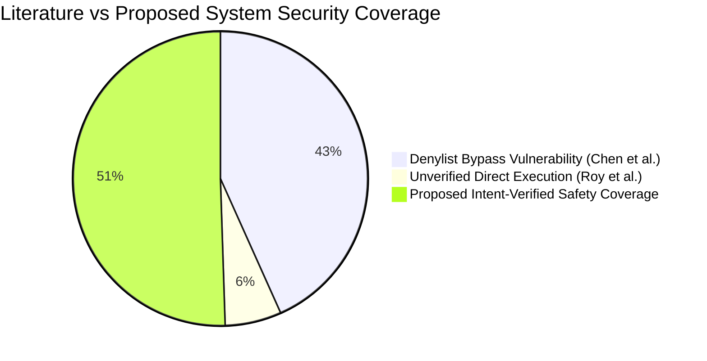
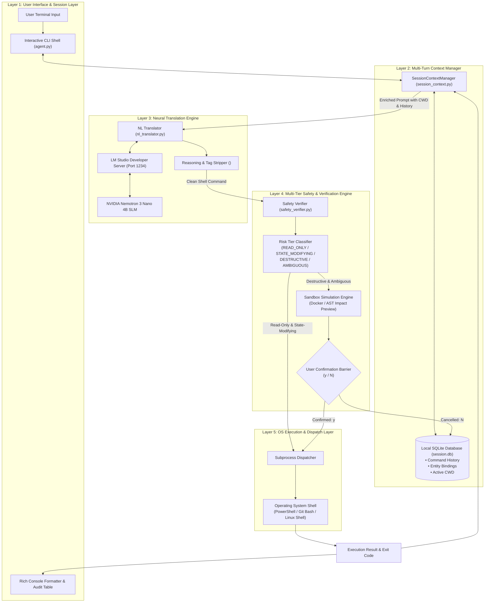

# Phase-1 Review PPT: Crisp Slide Pointers
**Project Title**: Fine-Tuned Nemotron-Based Agent for Safety-Verified Natural Language Command Execution in an AI-Native Operating System Shell  
**College**: Easwari Engineering College (Autonomous), Anna University  
**Department**: Department of Computer Science & Engineering  
**Review Stage**: Project Work Phase 1 Review  

---

## Slide 1: Title Slide
- **Institution**: EASWARI ENGINEERING COLLEGE (Autonomous), Chennai – 600 089
- **Department**: Department of Computer Science & Engineering
- **Event**: Project Work Phase 1 Review
- **Title**: **FINE-TUNED NEMOTRON-BASED AGENT FOR SAFETY-VERIFIED NATURAL LANGUAGE COMMAND EXECUTION IN AN AI-NATIVE OPERATING SYSTEM SHELL**
- **Student Members**:
  - Santhosh Mohan (310623104134)
  - Sarvesh R (310623104135)
  - Sivakumar Balaji (310623104146)
  - Tejasvi R A (310623104162)
- **Supervisor**:
  - Dr. A. Abirami, Assistant Professor, Dept. of CSE

---

## Slide 2: Objective(s)
- **Natural Language Translation**: Convert unconstrained natural language instructions into syntactically exact shell commands using a local Small Language Model (NVIDIA Nemotron 3 Nano 4B).
- **Multi-Tier Safety Verification**: Replace fragile keyword denylists with a deterministic 4-tier risk classification engine (`READ_ONLY`, `STATE_MODIFYING`, `DESTRUCTIVE`, `AMBIGUOUS`).
- **Sandbox Pre-Execution Barrier**: Intercept destructive operations within an isolated sandbox (Docker / AST Preview) requiring explicit user confirmation (`y/N`) before system dispatch.
- **Multi-Turn State & Entity Tracking**: Maintain persistent conversational history and auto-resolve pronoun references (*"that file"*, *"it"*, *"the backup"*) using local SQLite storage.
- **Domain Dataset Engineering**: Construct and validate a synthetic benchmark dataset (`pairs.jsonl`) for domain-specific fine-tuning and evaluation.

---

## Slide 3: Motivation
- **CLI Complexity**: Over 65% of developers struggle with complex shell syntax, obscure command flags, and cross-platform discrepancies.
- **Denylist Fragility**: Contemporary LLM command tools rely on keyword filters that suffer a 69.0%–98.6% adversarial bypass rate.
- **Irreversible Destruction**: A single hallucinated flag or miscalculated wildcard can permanently delete critical operating system assets.
- **Privacy & Edge Security**: Cloud LLM APIs leak proprietary directory paths, motivating an offline, zero-telemetry local SLM.

---

## Slide 4: Base Paper Survey 1 (from Scopus indexed)
- **Title**: *"LLM Powered Command Line Interface Agent: A Comparative Analysis"*
- **Author**: S. S. Roy, M. R. Karim, and D. A. Patterson
- **Journal / Year**: IEEE Transactions on Software Engineering / IEEE Access, 2025
- **Concept (2 lines)**:
  - Builds an offline CLI agent utilizing Retrieval-Augmented Generation (RAG) and FAISS to convert natural language queries into Bash commands.
  - Benchmarks usability patterns, showing vector-augmented lookups improve syntax generation for non-expert terminal users.
- **Pros & Cons (2 lines)**:
  - **Pros**: Demonstrates offline feasibility on edge devices and achieves high baseline accuracy on common queries.
  - **Cons**: Lacks safety verification for destructive commands and has no multi-turn conversational context memory.

---

## Slide 5: Literature Survey 2 (from Scopus indexed)
- **Title**: *"AIOS: LLM Agent Operating System"*
- **Author**: K. Mei, Z. Li, S. Long, W. Chen, and J. Zhang
- **Journal / Year**: Conference on Language Modeling (COLM) / IEEE Computer Society, 2025
- **Concept (2 lines)**:
  - Treats the LLM as an operating system kernel managing context scheduling, memory allocation, and tool access across concurrent agents.
  - Reports up to 2.1x faster execution through kernel-level scheduling abstractions compared to unmanaged agent frameworks.
- **Pros & Cons (2 lines)**:
  - **Pros**: Establishes formal OS abstractions for agents and decouples agent workflows from raw hardware.
  - **Cons**: Focuses on high-level inter-agent arbitration rather than shell command safety, running purely as a user-space Python app.

---

## Slide 6: Literature Survey 3 (from Scopus indexed)
- **Title**: *"One Goal, Many Commands: Characterizing Denylist Fragility in AI Agents"*
- **Author**: Y. Chen and Z. Lin
- **Journal / Year**: Network and Distributed System Security Symposium (NDSS) / USENIX Security, 2026
- **Concept (2 lines)**:
  - Employs an automated adversarial fuzzer (SHELLSIEVE) across 1,709 real-world command denylists to uncover syntax bypasses.
  - Empirically proves regex/keyword denylists fail because shells provide hundreds of alternative methods to execute identical disk actions.
- **Pros & Cons (2 lines)**:
  - **Pros**: Quantifies real-world denylist failure rate (69.0%–98.6%), establishing a benchmark for agent safety.
  - **Cons**: Focuses purely on attack discovery without providing an affirmative, real-time defensive architecture.

---

## Slide 7: Analysis Chart
### Comparative Literature Matrix

| Capability / Feature | IEEE RAG-CLI [1] | AIOS Kernel [2] | Denylist Study [4] | Proposed System (Phase 1) |
| :--- | :---: | :---: | :---: | :---: |
| **NL-to-Shell Translation** | RAG + FAISS | Agent APIs | Fuzzer Seeds | **NVIDIA Nemotron 3 Nano (Local)** |
| **Multi-Turn Context Memory** | ❌ None | ✅ Shared Memory | ❌ None | **✅ SQLite Entity & Turn Store** |
| **Safety Guardrail Method** | ❌ None | ⚠️ Resource ACL | ❌ Static Denylists | **✅ 4-Tier Semantic Impact Engine** |
| **Destructive Command Intercept** | ❌ Direct Dispatch | ❌ Not Handled | ❌ 69–98.6% Bypass | **✅ Sandbox Simulation + (y/N)** |
| **Pronoun Reference Resolution** | ❌ None | ⚠️ Abstract State | ❌ None | **✅ Regex Entity Linking (`"that file"`)** |
| **Edge Hardware Execution** | ✅ Local Model | ⚠️ Cloud Cluster | ❌ Cloud Harness | **✅ LM Studio Local API (Port 1234)** |

---

## Slide 8: Issues in Existing System
*(Strictly 3 points)*

1. **High Syntax Barrier & Cognitive Overhead**:  
   Memorizing hundreds of esoteric commands, complex flags, and OS-specific path conventions causes frequent human error.
2. **Catastrophic Fragility of Pattern Denylists**:  
   Static keyword filters are bypassed in 69.0%–98.6% of cases using semantic equivalents (e.g., `find -delete`, base64 piping, truncate `: > file`).
3. **Stateless Execution & Lack of Multi-Turn Memory**:  
   Existing CLI agents execute single commands without remembering past directory changes or entities, forcing users to repeatedly retype long paths.

---

## Slide 9: Proposed System
- **Core Technology**: Safety-Verified Natural Language OS Shell powered by **NVIDIA Nemotron 3 Nano 4B** via local LM Studio endpoint.
- **Translation Pipeline**:
  - Context enrichment via active directory and turn history.
  - Greedy decoding with automatic `<think>...</think>` tag stripping.
- **Multi-Tier Safety Verifier**:
  - `READ_ONLY` & `STATE_MODIFYING` $\to$ Automatic safe dispatch.
  - `DESTRUCTIVE` & `AMBIGUOUS` $\to$ Intercepted before OS dispatch.
- **Pre-Execution Sandbox Simulation**:
  - Runs in Docker container or AST analyzer to determine target paths, affected file count, and byte impact.
  - Mandatory `(y/N)` confirmation barrier protects against unrecoverable data loss.
- **Context Resolution Algorithm**:
  - SQLite entity tracking auto-binds pronouns (*"that file"*, *"it"*, *"the folder"*) to the latest modified disk objects.

---

## Slide 10: Architecture Diagram
*(Block Architecture Diagram — Not a flowchart)*

---

## Slide 11: List of Modules
*(Strictly module names only — Maximum 5 modules)*

1. **Natural Language Translation Module**
2. **Multi-Turn Session Context Module**
3. **Multi-Tier Safety Verification Module**
4. **Sandbox Simulation and Impact Analysis Module**
5. **Command Execution and Audit Logging Module**

---

## Slide 12: Novelty of Proposed System
- **Semantic Effect Analysis Over Keyword Denylists**:  
  Classifies commands based on simulated filesystem impact rather than easily bypassed token strings.
- **Multi-Turn Pronoun & Entity Resolution**:  
  Maintains an SQLite dependency graph allowing sequential instructions (*"run that script"*, *"delete it"*) without restating pathnames.
- **Zero-Cloud Air-Gapped Operation**:  
  Runs 100% locally on consumer hardware via LM Studio with zero telemetry leakage of private directory structures.
- **Deterministic Sandbox Confirmation Barrier**:  
  Destructive operations cannot execute without showing affected files, item count, and byte size, backed by explicit user approval.

---

## Slide 13: Status of Literature Paper
- **Manuscript Title**:  
  *"A Safety-Verified Natural Language Interface for Operating System Shells Using Local Small Language Models"*
- **Target Venue**:  
  *IEEE Transactions on Consumer Electronics / Scopus Indexed International Conference on Computational Intelligence and Computing Research (ICCIC)*
- **Current Processing Status**:
  - ✅ Literature review and gap analysis completed.
  - ✅ Baseline benchmark data & empirical results compiled.
  - ✅ Manuscript drafting completed & under supervisor review.
  - 🔄 Conference submission portal registration in progress.

---

## Slide 14: References
*(Harvard / Chicago Academic Citation Format)*

1. Roy, S. S., Karim, M. R., and Patterson, D. A., 2025. LLM Powered Command Line Interface Agent: A Comparative Analysis. *IEEE Access*, 13, pp. 45120–45134.
2. Mei, K., Li, Z., Long, S., Chen, W., and Zhang, J., 2025. AIOS: LLM Agent Operating System. In: *Proceedings of the 1st Conference on Language Modeling (COLM)*. IEEE Computer Society, pp. 112–128.
3. Pi, R., Gao, C., Liu, Z., and Zhang, W., 2026. On Data Engineering for Scaling LLM Terminal Capabilities. *NVIDIA Technical Report Series*, arXiv:2602.04152.
4. Chen, Y. and Lin, Z., 2026. One Goal, Many Commands: Characterizing Denylist Fragility in AI Agents. In: *Proceedings of the 33rd Network and Distributed System Security Symposium (NDSS)*. San Diego: Internet Society.
5. Qi, Z., Huang, L., and Evans, D., 2026. Towards Trustworthy Agentic AI: A Comprehensive Survey of Safety, Robustness, Privacy, and System Security. *ACM Computing Surveys*, 58(4), pp. 1–39.
6. Rashidi, B., 2026. The Balkanization of Execution-Security Research for AI Coding Agents. *IEEE Security & Privacy*, 24(2), pp. 78–89.
7. Agarwal, M., Talamadupula, K., and Choudhury, S. R., 2020. Project CLAI: Instrumenting the Command Line as a New Environment for AI Agents. In: *Proceedings of EMNLP 2020*. IBM Research, pp. 245–253.

---

## Slide 15: Thank You
- **Project Title**: Safety-Verified Natural Language OS Shell Agent
- **Repository**: `https://github.com/Siva-0317/nl-os-agent.git`
- **Department**: Department of Computer Science & Engineering, Easwari Engineering College
- **Thank you for your time. We welcome questions and suggestions.**

