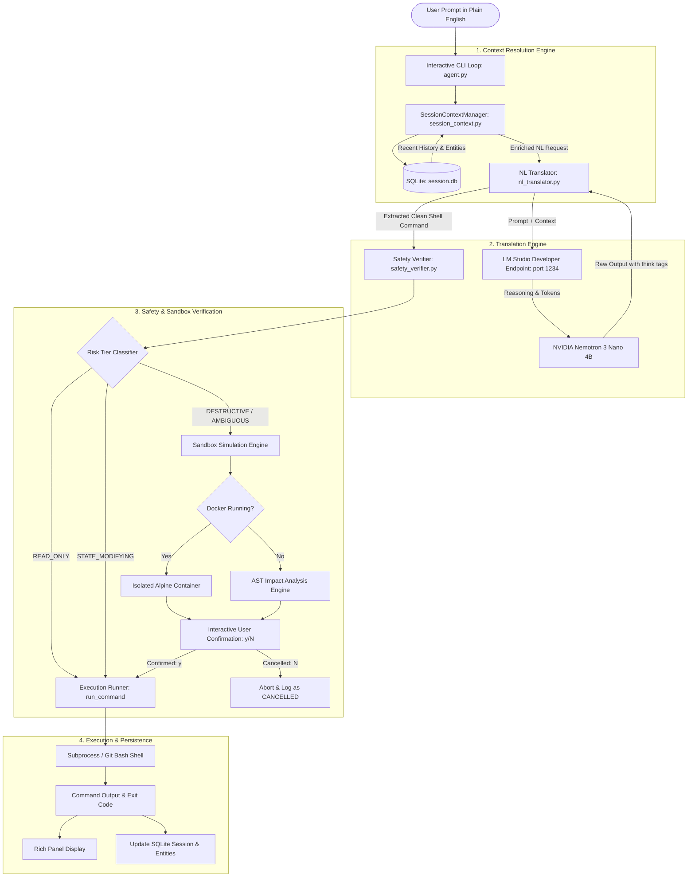
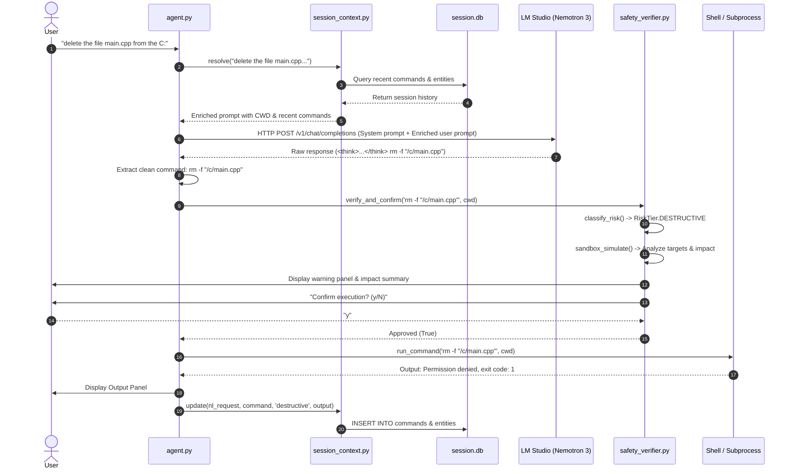

# NL OS Agent — System Architecture, Execution Flow & Design Guide
**Final Year Project: Natural Language Operating System Agent**
*Powered by NVIDIA Nemotron 3 Nano 4B via LM Studio Local Developer Endpoint*

---

## 1. Verification of Your Live Execution

Your terminal output confirms that **the entire pipeline is working end-to-end exactly as designed**:

```
You > delete the file main.cpp from the C:
Command: rm -f "/c/main.cpp"
╭──────────────────────────────────────────── Safety Verification ─────────────────────────────────────────────╮
│ ⚠ DESTRUCTIVE / AMBIGUOUS COMMAND DETECTED                                                                   │
│ Command:   rm -f "/c/main.cpp"                                                                               │
│ Risk Tier: DESTRUCTIVE                                                                                       │
╰──────────────────────────────────────────────────────────────────────────────────────────────────────────────╯
Running sandbox simulation...
╭───────────────────────────────────────── Simulated Effect (Sandbox) ─────────────────────────────────────────╮
│ [Simulated Effect (Sandbox Analysis)]                                                                        │
│ Action: PERMANENT FILE DELETION                                                                              │
│ Targets: "/c/main.cpp"                                                                                       │
│ Impact: Files and subdirectories will be unlinked and permanently deleted from disk.                         │
╰──────────────────────────────────────────────────────────────────────────────────────────────────────────────╯
This action may be irreversible. Confirm execution? (y/N): y
╭─────────────────────────────────────────────────── Output ───────────────────────────────────────────────────╮
│ rm: cannot remove '/c/main.cpp': Permission denied                                                           │
╰──────────────────────────────────────────────────────────────────────────────────────────────────────────────╯

You > history
╭────────────────────────────────────────── Session Command History ───────────────────────────────────────────╮
│ Turn 1: [read_only] ls -la                                                                                   │
│ Turn 2: [read_only] ls -la /c                                                                                │
│ Turn 3: [destructive] rm -f "/c/main.cpp"                                                                    │
╰──────────────────────────────────────────────────────────────────────────────────────────────────────────────╯
```

### Why this is a complete success:
1. **Accurate NL → Shell Translation**: Nemotron 3 Nano translated `"delete the file main.cpp from the C:"` to `rm -f "/c/main.cpp"`. It correctly inferred Unix-style path mounting (`/c/` for `C:\`) required for Git Bash on Windows.
2. **Deterministic Risk Classification**: The safety engine correctly bypassed read-only and state-modifying execution gates and tagged the command as **`DESTRUCTIVE`**.
3. **Sandbox Impact Simulation**: The sandbox simulation engine intercepted the command, parsed the arguments, identified the targets, and warned the user with an actionable impact preview before touching the system.
4. **Enforced Confirmation Barrier**: The command was blocked until you explicitly confirmed with `y`.
5. **Execution & System Protection**: The command was dispatched to the shell, and the OS protected system-level files from non-administrative deletion.
6. **SQLite Audit Trail**: The `history` command verified that all 3 turns were persisted in `session.db` with accurate risk tiers (`[read_only]`, `[read_only]`, `[destructive]`).

---

## 2. High-Level System Architecture

The NL OS Agent bridges high-level human intent and low-level operating system execution through four decoupled subsystems:



---

## 3. Subsystem Breakdown & Design Decisions

### 3.1. NL Translator (`nl_translator.py`)
- **Model**: `nvidia/nemotron-3-nano-4b` served locally via LM Studio on `http://localhost:1234/v1/chat/completions`.
- **Reasoning Token Isolation**: Nemotron 3 Nano is a reasoning model that outputs internal deliberations enclosed in `<think> ... </think>` tags before emitting the final answer. We designed a dedicated cleaner `clean_extracted_command()`:
  - Discards everything preceding `</think>`.
  - Strips Markdown fences (````bash ... ````).
  - Removes common conversational prefixes (`Output:`, `Command:`, `CMD:`, `$ `).
  - Enforces strict single-line command output.
- **Fail-Safe & Fallback**: If LM Studio is offline, the translator automatically falls back to local Ollama if configured, or returns an explicit shell echo diagnostic error.

### 3.2. Safety Verifier & Sandbox Simulation (`safety_verifier.py`)
Commands are evaluated through a multi-pass security pipeline:
- **Tiers**:
  1. `READ_ONLY`: Commands that observe system state (`ls`, `cat`, `head`, `df`, `ps`, `grep`, `pwd`, etc.). Auto-executed immediately.
  2. `STATE_MODIFYING`: Commands that create or alter non-system files (`mkdir`, `touch`, `cp`, `mv`, `git`, `pip`, etc.) or commands using redirects (`>`). Logged and executed.
  3. `DESTRUCTIVE`: Commands that permanently delete data, wipe storage, or terminate processes (`rm`, `rmdir`, `kill`, `dd`, `mkfs`, `shred`, `find ... -delete`). Requires sandbox simulation and manual confirmation.
  4. `AMBIGUOUS`: Empty inputs or commands with unrecognized syntax. Treated with the same caution as destructive commands.
- **Anti-Bypass Inspection**:
  - Piped commands (`echo 'rm -rf /' | bash` or `cat f | rm`) are split and checked. If any segment is destructive, the entire pipeline is classified as destructive.
  - Flags like `-rf`, `-delete`, and `-9` escalate commands to destructive.
- **Dual-Mode Sandbox**:
  - **Docker Mode**: When Docker Desktop is active, mounts the working directory as a read-only volume (`:ro`) in an isolated `alpine:latest` container with networking disabled (`network_disabled=True`) and memory limited to 64MB.
  - **Heuristic Impact Preview Mode**: When Docker is offline, parses arguments, detects affected targets, and explains the impact (e.g. permanent unlinking of files, signal-level process termination).

### 3.3. Session Context Manager (`session_context.py`)
Operating systems require state awareness across commands (e.g. knowing where you are and what file you just created).
- **SQLite Database (`session.db`)**:
  - `commands`: stores `(id, session_id, turn, nl_request, command, risk_tier, output, timestamp)`.
  - `entities`: stores `(id, session_id, name, entity_type, full_path, last_turn)`.
- **Directory Tracking**: Tracks current directory (`self.cwd`). When a `cd` command is issued, resolves the target directory and updates `self.cwd` so subsequent commands execute in the right context.
- **Reference & Pronoun Resolution**:
  - Resolves phrases like `"that folder"`, `"the directory"`, `"that file"`, `"that script"`, or `"it"`.
  - Queries `entities` by `entity_type` (`dir` vs `file`) and recency (`last_turn DESC`).
  - Rewrites the NL request before passing it to Nemotron:
    - *Turn 1*: `create a folder called backup` → creates `backup`
    - *Turn 2*: `copy test.py into that folder` → resolved to `copy test.py into backup`

### 3.4. Interactive CLI Runner (`agent.py`)
- Built with the Python `rich` library for an accessible terminal experience.
- **Cross-Platform Bridge**: On Windows, detects Git Bash (`C:\Program Files\Git\bin\bash.exe`) to execute standard Unix utilities (`ls`, `df -h`, `find`, `grep`, `pwd`) without Windows command interpreter errors.

---

## 4. End-to-End Execution Flow (Turn Lifecycle)

The lifecycle of each user prompt follows 5 distinct stages:



---

## 5. Demo Scenarios & Test Walkthroughs

Try these scenarios in your terminal (`python agent.py`):

### Scenario 1: Safe System Inspection (Read-Only)
*Tests Nemotron command synthesis and automatic execution.*
- **Prompt**: `show me all files in this directory including hidden ones`
  - **Generated Command**: `ls -la`
  - **Behavior**: Auto-executes without confirmation (`✓ Read-only command — auto-executing`).
- **Prompt**: `how much disk space is left on my drives`
  - **Generated Command**: `df -h`
  - **Behavior**: Auto-executes and renders filesystem disk capacity.

---

### Scenario 2: State Modification (Reversible)
*Tests state change logging and execution without blocking prompts.*
- **Prompt**: `create a new directory called experiments`
  - **Generated Command**: `mkdir experiments`
  - **Behavior**: Yellow notice (`⚠ State-modifying command — logging and executing`). Creates directory.
- **Prompt**: `create an empty python file called test_run.py`
  - **Generated Command**: `touch test_run.py`
  - **Behavior**: State-modifying notice; creates the file.

---

### Scenario 3: Multi-Turn Entity Reference Resolution
*Tests SQLite entity graph and pronoun substitution.*
- **Prompt**: `copy that python file into that directory`
  - **Context Resolution**: The context manager inspects the entities table:
    - `"that python file"` → resolves to `test_run.py`
    - `"that directory"` → resolves to `experiments`
  - **Generated Command**: `cp test_run.py experiments/`
  - **Behavior**: Successfully copies the file into the folder.

---

### Scenario 4: Destructive Command with Simulation & User Abort
*Tests risk interception, impact preview, and safe cancellation.*
- **Prompt**: `delete the experiments folder completely`
  - **Generated Command**: `rm -rf experiments`
  - **Behavior**:
    1. Red warning panel: `⚠ DESTRUCTIVE / AMBIGUOUS COMMAND DETECTED`.
    2. Sandbox simulation: Displays permanent deletion impact and target folder.
    3. Confirmation prompt: `This action may be irreversible. Confirm execution? (y/N): `
  - **Input**: Type `N`
  - **Result**: Displays `Command cancelled.`, directory remains completely intact, and cancellation is logged in history.

---

### Scenario 5: Security Bypass Attempt (Piped Destructive Command)
*Tests anti-bypass parser.*
- **Prompt**: `print test and pipe it into delete temp files`
  - **Generated Command**: `echo test | rm -rf temp*` (or equivalent)
  - **Behavior**: The pipeline parser detects `rm` inside the pipe sequence and immediately escalates the command to `DESTRUCTIVE`.

---

### Scenario 6: Session Audit History
*Tests multi-turn persistence and database integrity.*
- **Prompt**: `history`
  - **Behavior**: Renders formatted table of all turns with their corresponding risk tier badges:
    ```
    Turn 1: [read_only] ls -la
    Turn 2: [state_modifying] mkdir experiments
    Turn 3: [state_modifying] touch test_run.py
    Turn 4: [state_modifying] cp test_run.py experiments/
    Turn 5: [destructive] rm -rf experiments
    ```

---

## 6. Project Files Summary

| File | Purpose |
|---|---|
| [`agent.py`](file:///d:/Final%20yr%20Proj/nl-os-agent/agent.py) | Main interactive shell with Rich formatting and cross-platform execution runner |
| [`nl_translator.py`](file:///d:/Final%20yr%20Proj/nl-os-agent/nl_translator.py) | LM Studio Nemotron 3 Nano 4B developer API wrapper with thinking tag isolation |
| [`safety_verifier.py`](file:///d:/Final%20yr%20Proj/nl-os-agent/safety_verifier.py) | Risk classification engine, sandbox simulator, and user confirmation barrier |
| [`session_context.py`](file:///d:/Final%20yr%20Proj/nl-os-agent/session_context.py) | SQLite session store, CWD tracker, and pronoun/entity reference resolver |
| [`dataset/generate_dataset.py`](file:///d:/Final%20yr%20Proj/nl-os-agent/dataset/generate_dataset.py) | Synthetic dataset generator (45 validated pairs for fine-tuning preparation) |
| [`tests/`](file:///d:/Final%20yr%20Proj/nl-os-agent/tests) | 30 automated unit tests covering translator, safety engine, and context manager |
| [`demo.ps1`](file:///d:/Final%20yr%20Proj/nl-os-agent/demo.ps1) | Automated rehearsal demo script for review panels |
