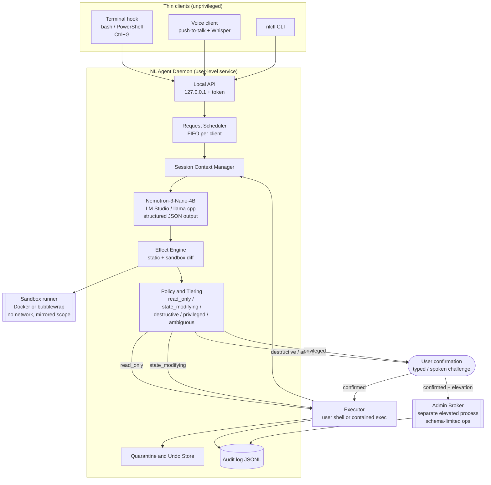

# Next Steps: From Working Prototype to a Fully Functional NL-OS Agent

Covers: OS-level integration, text + voice, sandbox + admin access, fine-tuning (GGUF to real training), what makes the project unique, and how to evaluate it for the report.

---

## 0. Where you are, honestly

Your output shows the pipeline works end to end (translate, classify, confirm, execute, history). Good. Three things a reviewer will catch, so fix them before scaling:

| # | Observation in your run | Why it matters | Fix (section) |
|---|---|---|---|
| 1 | `classify_risk()` matches command names (`rm`, `kill`...) | This is the same family as a denylist. The paper claims classification by **simulated effect**, not text pattern. | §4 Effect Engine |
| 2 | The "Simulated Effect" box says "Files and subdirectories will be unlinked" for a single `rm -f file` | That is a template per command, not a real simulation. | §4 |
| 3 | `rm: Permission denied` on `C:\` root, and the model produced MSYS paths (`/c/main.cpp`) | The agent does not know the target shell/OS, and has no policy for "this needs admin". | §3, §5, §7 |

Also: running every command with a fresh `subprocess.run(shell=True)` means `cd` and `export` never persist. Real shell integration (§3) fixes that.

**Model correction for your report.** You are using `NVIDIA-Nemotron-3-Nano-4B`. Per its model card it is a Mamba2-Transformer hybrid (about 3.97B parameters, compressed from Nemotron-Nano-9B-v2, NVIDIA Open Model License). It is **not** the 30B-A3B MoE I described earlier in Ch. 2 [7]. Update that paragraph and Table 5.2. The 4B model also removes the "needs an 80 GB GPU" challenge in §1.3: LoRA on it fits a 24 GB card, and Unsloth reports it fits a free Colab GPU.

---

## 1. What is actually unique (use this in the report)

### 1.1 Do not claim "we are the first to sandbox agents"
OS-level sandboxing of agent commands already ships in mainstream tools: Codex CLI (Seatbelt on macOS, Landlock + seccomp on Linux, restricted tokens on Windows), Claude Code's sandboxed bash tool (Seatbelt / bubblewrap + network proxy), Gemini CLI (Seatbelt or Docker/Podman), plus open projects such as `nono` and `vetto`. A third-party comparison also lists an NVIDIA "OpenShell" sandbox (verify before citing).

Those systems do **containment**: they limit *where* a command can write or connect. They do not tell the user *what this specific command will do*, and they do not derive a risk tier from the effect.

### 1.2 Defensible contributions

| Contribution | How it differs from related work | Must be backed by |
|---|---|---|
| **C1. Effect-derived risk tiering** (tier computed from a resolved/simulated file-system diff, not command names) | Denylists and name-based classifiers match text [4]; containment tools do not classify | Bypass benchmark (§9) |
| **C2. Effect preview before commit** ("DELETE 47 files, 2.3 MB: paths...") | Containment shows nothing; llm-cmd-style tools rely on the user reading the command | User-study or at least confirmation-quality metrics |
| **C3. Reversible execution** (destructive ops go to a quarantine, `undo` restores) | Most agents execute `rm` for real | Undo success rate |
| **C4. Privilege-separated admin broker** (LLM never holds admin rights; elevation is a separate, schema-limited, user-confirmed path) | Typical agents either run unprivileged and fail, or get blanket `sudo` | Design + audit log |
| **C5. Voice-safe confirmation** (spoken destructive commands need read-back and a challenge phrase containing the effect count) | Voice assistants for shells rarely address misrecognition risk | Voice test set |
| **C6. Small, local, domain-tuned model** (4B, offline, private) vs hosted frontier models | Coding agents are typically paired with hosted models | Exec-accuracy vs baselines (§8) |
| **C7. Session entity resolution at shell level** ("delete that file" resolved from tracked entities) | AIOS context manager handles LLM-compute context, not semantic references | Reference-resolution accuracy |

### 1.3 Comparison table (paste into Ch. 2 / Ch. 8; verify cells before submission)

| System | Where it runs | Safety mechanism | Effect preview | Undo | Privilege separation | Voice | Local small model |
|---|---|---|---|---|---|---|---|
| AIOS [2] | Python app layer on top of the OS (its kernel relies on OS syscalls) | Generic access control between agents | No | Storage versioning (not command undo) | No | No | Backend-agnostic |
| Codex CLI / Claude Code / Gemini CLI | User-space CLI agents | OS sandbox + approval modes | No | Git-based, not per command | Sandbox profiles, not a broker | Not core | Typically hosted models |
| llm-cmd (simonw) | Shell plugin | User reviews the generated command | No | No | No | No | Any LLM backend |
| NL2SH (NAACL 2025) | Research code | Translation focus | No | No | No | No | Yes |
| **This project** | Daemon + shell hooks (+ voice client) | Effect-derived tiers + sandbox + confirmation | **Yes** | **Yes (quarantine)** | **Yes (broker)** | **Yes** | **Yes (4B)** |

Scoping rule for wording: say "to the best of our knowledge, among the systems we reviewed". Never write "first" without that qualifier. Your submitted novelty text claimed the first mechanism "evaluated against the bypass techniques in prior denylist research". That is only true once you actually run that evaluation (§9).

### 1.4 Related work to add (verify each on arXiv before citing)
- Fault-tolerant / transactional sandboxing for AI coding agents (arXiv 2512.12806): supports C3.
- Deterministic pre-action authorization for agents (arXiv 2603.20953): supports the "gate before tool call" design.
- Codex sandbox write-ups and the Claude Code sandbox docs: cite as technical documentation.

---

## 2. Target architecture (v1.0)



Design rules:
1. The LLM only **proposes**. A deterministic policy engine decides. The model never executes or elevates.
2. One decision point (the daemon). Clients are thin, so text and voice share identical safety.
3. Everything is logged (audit JSONL). The same log later feeds evaluation and fine-tuning data.

---

## 3. OS integration ("works like a wrapper next to the OS")

Recommended platform decision (you are on Windows with Git Bash paths):

| Option | Pros | Cons | Verdict |
|---|---|---|---|
| **A. Linux/WSL2 as the reference platform** (daemon as systemd service inside WSL2, Windows Terminal profile starts it) | Real sandbox primitives (bubblewrap/Docker/overlay), `systemd` matches your report, simplest privilege broker (polkit/sudo) | Windows files accessed through `/mnt/c` (slower, permissions differ) | **Choose this for v1.0** |
| B. Native Windows (Windows service + PowerShell hooks + Job Objects/AppContainer) | True native feel | Much more engineering; sandbox/elevation via UAC/AppContainer is harder | Phase 3 stretch goal |
| C. Keep Git Bash | Already works | No sandbox primitives, MSYS path quirks, no service model | Dev only |

Notes: recent WSL builds can run systemd if `systemd=true` is set under `[boot]` in `/etc/wsl.conf`. If LM Studio runs on the Windows host and `localhost` does not reach it from WSL, enable mirrored networking or use the host IP, and turn on LM Studio's local server.

### 3.1 Daemon + thin clients
- Daemon: FastAPI/uvicorn bound to `127.0.0.1`, random bearer token stored at `~/.nl-agent/token` (mode 600). Endpoints: `POST /v1/propose`, `POST /v1/commit`, `POST /v1/undo`, `GET /v1/history`, `WS /v1/events`.
- Run as a user-level service (systemd `--user`) under a dedicated unprivileged identity. Never run the daemon as root/admin.
- Minimal systemd user unit:

```ini
# ~/.config/systemd/user/nl-agent.service
[Unit]
Description=NL OS Agent daemon
[Service]
ExecStart=%h/nl-agent/venv/bin/python -m nlagent.daemon
Restart=on-failure
NoNewPrivileges=yes
ProtectSystem=strict
ReadWritePaths=%h/.nl-agent
[Install]
WantedBy=default.target
```

### 3.2 Shell hook: type English, get a vetted command in your real shell
Two-step design (propose, then commit) keeps `cd`/`export` working because the approved command is evaluated by the user's own shell:

```bash
# ~/.bashrc  (Ctrl+G turns the English on the line into a proposal)
_nl_propose() {
  [[ -z "$READLINE_LINE" ]] && return
  local id; id=$(nlctl propose --cwd "$PWD" --shell bash -- "$READLINE_LINE") || return
  READLINE_LINE="eval \"\$(nlctl commit $id --emit-shell)\""
  READLINE_POINT=${#READLINE_LINE}
}
bind -x '"\C-g": _nl_propose'
```
`nlctl propose` prints the tier and effect preview to stderr. `nlctl commit` re-checks the policy, asks for confirmation if needed, and only then prints the approved command. Pressing Enter runs it in your shell.

PowerShell equivalent (for the Windows-native stretch goal):

```powershell
Set-PSReadLineKeyHandler -Chord Ctrl+g -ScriptBlock {
  $line = $null; $cursor = $null
  [Microsoft.PowerShell.PSConsoleReadLine]::GetBufferState([ref]$line, [ref]$cursor)
  $id = nlctl propose --cwd (Get-Location).Path --shell powershell -- $line
  [Microsoft.PowerShell.PSConsoleReadLine]::Replace(0, $line.Length, "Invoke-Expression (nlctl commit $id --emit-shell)")
}
```

### 3.3 Pass the real environment to the model
Add to every request: OS, shell (bash / PowerShell / cmd), cwd, home, available tools (`which`), and path style. This alone prevents the `/c/main.cpp` style mistakes.

### 3.4 Structured model output
Make the model return JSON, not a bare string, and validate it:

```json
{"command": "rm -f ./main.cpp", "targets": ["./main.cpp"], "needs_clarification": false,
 "clarifying_question": null, "shell": "bash"}
```
LM Studio's OpenAI-compatible endpoint supports JSON-schema structured output on recent versions (check yours). The Nemotron-3-Nano-4B card says reasoning is switchable via the system prompt; turn it off for command generation to cut latency (read the card for the exact switch).

---

## 4. Effect Engine (replaces name-based classification)

Two layers. Both are in `nl_agent_v1_code/` (tested: 16/16 static cases, plus dynamic diff).

**Layer A: static effect resolution** (`effects.py`). Parse the command, expand globs against the real filesystem **read-only**, count what would be deleted/overwritten/created/appended, and flag protected paths and opaque forms (`eval`, `$(...)`, `base64 | bash`, inline interpreters). Rewrites `find ... -delete` into a safe `find ...` listing to preview matches.

**Layer B: sandboxed dynamic run** for anything Layer A calls opaque or too complex. Run the command in a no-network container against a **same-path mirror** of the scope, take a manifest (path, size, hash, mode) before and after, and diff. `manifest.py` has `manifest()`, `diff()`, and `tier_from_diff()`.

Dynamic runner outline (Docker; not executed in my environment, test it on your machine first):

```python
# sandbox_run.py (sketch)
import subprocess, tarfile, io, json, uuid
def dynamic_effect(command, cwd, scope_paths, max_mb=200):
    name = f"nlsbx-{uuid.uuid4().hex[:8]}"
    subprocess.run(["docker","run","-d","--name",name,"--network","none","--memory","256m",
                    "--pids-limit","128","--cap-drop","ALL","--security-opt","no-new-privileges",
                    "alpine:3.20","sleep","300"], check=True)
    try:
        # 1) stream scope into the container at the SAME absolute paths
        tar = subprocess.Popen(["tar","-C","/","-cf","-"]+[p.lstrip("/") for p in scope_paths], stdout=subprocess.PIPE)
        subprocess.run(["docker","exec","-i",name,"tar","-C","/","-xf","-"], stdin=tar.stdout, check=True)
        snap = "find %s -printf '%%p|%%s|%%m\\n' | sort" % " ".join(scope_paths)
        before = subprocess.check_output(["docker","exec",name,"sh","-c",snap]).decode()
        subprocess.run(["docker","exec","-w",cwd,name,"sh","-c",command], capture_output=True, timeout=15)
        after  = subprocess.check_output(["docker","exec",name,"sh","-c",snap]).decode()
        return before, after   # diff these (add sha1sum if you need content changes)
    finally:
        subprocess.run(["docker","rm","-f",name], capture_output=True)
```
Rules: never run a dry-run on the host; cap scope size (for example 200 MB / 5,000 files) and fall back to "estimated, static only" above it; Alpine's `sh` differs from your user's shell, so for fidelity use an image with the same shell.

Tier mapping (derived from effect, not names):

| Effect found | Tier | Action |
|---|---|---|
| No FS change, no signals | `read_only` | Auto-run |
| Only creates / appends | `state_modifying` | Run + log (+ quarantine nothing) |
| Any delete, overwrite, truncate, permission change, process signal | `destructive` | Preview + typed/spoken confirm; deletes go to quarantine |
| Touches protected system path | `privileged` | Admin broker path only (§5) |
| Opaque form, network/package effects, unparseable | `ambiguous` | Preview what is knowable + confirm, or ask a clarifying question |

**Known limits (state them in the paper's threats-to-validity):** simulation cannot capture network or other external effects, time-dependent behaviour, or differences between sandbox and host; TOCTOU between preview and commit (mitigate by re-running Layer A at commit and comparing); processes and services cannot be fully mirrored in a container.

---

## 5. Sandbox and administrative access (privilege separation)

Principle: a compromised or mistaken model must not equal root.

| Component | Runs as | Can do | Cannot do |
|---|---|---|---|
| Daemon + LLM | Dedicated unprivileged user | Propose, analyse, log | Write outside user scope, elevate |
| Executor | Same user (optionally inside Landlock/bubblewrap, no network for `read_only`/untrusted runs) | Run approved commands | Reach protected paths |
| **Admin broker** | Separate elevated process (systemd system service or on-demand `pkexec`/UAC) | Perform a **fixed schema** of operations | Execute arbitrary shell strings |

Broker contract (structured requests only, never raw shell):

```json
{"op": "service_restart", "args": {"name": "nginx"}, "request_id": "...", "approved_by": "user", "preview_hash": "sha256:..."}
```
Initial op allowlist (keep it to 4 to 6): `package_install` (from an allowlisted manager), `service_restart`, `edit_file_in_etc` (specific files, with backup), `set_permissions` (path allowlist), `kill_process` (any PID owned by another user). Each op has a validator, writes to an append-only audit log, and requires the `preview_hash` that matches what the user approved (stops TOCTOU swaps).

Elevation triggers: `privileged` tier, or an execution failing with "Permission denied" (your `C:\main.cpp` case). The agent must say "this needs administrator rights; here is exactly what will change; approve with elevation?" and the approval for elevation is **keyboard-only** (UAC / sudo prompt), never voice.

Containment as defence in depth (stretch goal): run the executor under Landlock (Linux) with a write-scope of the project directory plus quarantine, network off by default. This matches what Codex/Claude Code do and composes with your effect preview.

---

## 6. Voice pipeline

```
push-to-talk key -> mic capture -> VAD -> faster-whisper (offline) -> transcript
   -> show transcript (editable) -> same /v1/propose path as text
   -> TTS read-back of tier + effect (optional)
```

Components (all offline): `sounddevice` (capture), `silero-vad` or `webrtcvad`, `faster-whisper` with `small.en` or `base.en` (int8 on CPU is usable), `piper` or the OS speech engine for read-back.

Skeleton:

```python
# voice_client.py (sketch)
import sounddevice as sd, numpy as np, requests
from faster_whisper import WhisperModel
asr = WhisperModel("small.en", compute_type="int8")
def listen(seconds=6, sr=16000):
    audio = sd.rec(int(seconds*sr), samplerate=sr, channels=1, dtype="float32"); sd.wait()
    segs, _ = asr.transcribe(audio[:,0], language="en",
                             initial_prompt="Terminal commands: ls, cd, grep, folder, directory, delete, copy, move.")
    return " ".join(s.text for s in segs).strip()
text = listen()
print("Heard:", text)                       # always show it
r = requests.post("http://127.0.0.1:8750/v1/propose", json={"text": text, "source": "voice"},
                  headers={"Authorization": f"Bearer {TOKEN}"})
```

**Voice-specific safety rules (this is your C5 contribution):**
1. Voice input is marked `source=voice`. For anything above `read_only`, show the transcript and require confirmation.
2. Destructive via voice: read back the **effect** ("delete 3 files, 1.2 MB, from Documents/old"), then require a challenge phrase containing the count: "confirm delete three files". A bare "yes" is not accepted, which defends against mishearing and ambient audio ("move" vs "remove").
3. Elevation, quarantine purge, and broker operations are never confirmable by voice.
4. Log ASR confidence; low confidence forces typed confirmation.

Measure: word error rate on a command-vocabulary test set (record 100 utterances from the 4 of you), and end-to-end voice task success.

---

## 7. Undo / quarantine (reversible destructive operations)

- For `rm`, overwrites, `mv` over existing files: before executing, move the affected items into `~/.nl-agent/quarantine/<request_id>/` preserving paths, write a manifest, then perform the operation.
- `nlctl undo [request_id]` restores from the manifest. Auto-purge after N days or a size cap; purge is keyboard-only.
- Report metric: undo success rate and storage overhead.
- Limitation to state: undo covers file operations, not process kills, network effects, or package installs.

---

## 8. Fine-tuning plan (GGUF is inference only)

You cannot meaningfully train from the GGUF. Pipeline:

```
dataset (JSONL) -> LoRA on HF checkpoint -> merge -> convert to GGUF -> quantize -> LM Studio
nvidia/NVIDIA-Nemotron-3-Nano-4B-BF16   ...............................  Q4_K_M or Q8_0
```

### 8.1 Data (target 8k to 15k examples)
| Source | Use | Note |
|---|---|---|
| Your synthetic seed generator (expand to 100+ templates, 5 categories) | Core | Validate each pair by execution diff in the sandbox |
| NL2SH / NL2Bash style public data | Breadth | Check each licence before use |
| Your own audit logs from real use | Realism | Only commands that were approved and succeeded |
| **Clarification examples** (ambiguous request -> `needs_clarification: true` + question) | Teaches the model to ask | About 10 to 15 % of data |
| **Environment-conditioned examples** (same request, bash vs PowerShell vs cmd; paths styles) | Fixes `/c/...` errors | Include OS/shell in the prompt |
| Retrieval few-shot (FAISS top-3) inside the prompt | Matches inference | Train with retrieved examples present |

Split **by template family**, not by paraphrase, otherwise paraphrases of the same command leak into the test set and inflate accuracy.

Format (chat JSONL):
```json
{"messages":[
 {"role":"system","content":"You output JSON only. OS=Ubuntu(WSL2) shell=bash cwd=/home/u/proj ..."},
 {"role":"user","content":"find files bigger than 100MB"},
 {"role":"assistant","content":"{\"command\":\"find . -type f -size +100M\",\"targets\":[],\"needs_clarification\":false}"}]}
```

### 8.2 Training (choose one route)
| Route | Hardware | Notes |
|---|---|---|
| **Unsloth LoRA** (4-bit possible) | Free Colab GPU or ~8 GB VRAM reported by a community repo | Fastest start |
| HF `transformers` + `peft` + `trl` | 24 GB GPU (RTX 3090 class) | One tutorial had to load BF16 and use LoRA rather than 4-bit QLoRA |
| **NVIDIA NeMo AutoModel** | Linux GPU / NGC container | Official LoRA recipe for this exact model (`nemotron_nano_4b_squad_peft.yaml`); best story for an NVIDIA-based project |

Gotchas reported for this hybrid architecture: it needs `mamba-ssm` and `causal-conv1d` (CUDA builds, Linux), and `attn_implementation="eager"` because Flash Attention is incompatible with the Mamba layers. Train on Linux/Colab/WSL2 with CUDA, not on Windows. Pin library versions to a working tutorial and do not copy Llama `target_modules`; take them from the Unsloth notebook or the NeMo recipe.

Starting hyperparameters (tune on validation): rank 16, alpha 32, dropout 0.05, lr 2e-4, 2 to 3 epochs, max sequence length 1024 to 2048, effective batch 32.

### 8.3 Merge, convert, serve
```bash
python merge.py                      # merge LoRA into BF16 base -> ./nemotron-merged
python llama.cpp/convert_hf_to_gguf.py ./nemotron-merged --outfile nl-agent-bf16.gguf
./llama.cpp/build/bin/llama-quantize nl-agent-bf16.gguf nl-agent-Q4_K_M.gguf Q4_K_M
# copy into LM Studio's models folder, or: llama-server -m nl-agent-Q4_K_M.gguf
```
Verify that the `convert_hf_to_gguf.py` in your llama.cpp checkout supports the Nemotron-H architecture (the public GGUFs exist, so it does in current builds).

### 8.4 What to report
Same test set, four models: (1) base Nemotron-4B zero-shot, (2) base + RAG, (3) fine-tuned, (4) fine-tuned + RAG. Metric = **execution-based accuracy** (run in sandbox, compare resulting state or output to the reference), not string match, plus JSON validity rate, clarification precision/recall, latency (p50/p95), tokens/s.

---

## 9. Evaluation to fill Chapters 8 to 9 (with real numbers)

**Important correction to my earlier file.** In `All_Figures_Mermaid_Code.md`, Figs 8.1 and 8.2 contain **placeholder numbers I made up** (for example 91.2, 87.4, 4.2, 71, 89). They are labelled "target" but must not appear as results. Replace them with your measured values or delete the figures until you have data.

### 9.1 Safety benchmark ("DestructiveBench-mini")
Build 300 to 500 cases, all executed only in disposable temp directories or containers: each case = intent + a command that achieves it. Group by technique:
`direct (rm -rf)`, `alternate tool (find -delete, rsync --delete, git clean -fdx, shred)`, `truncation/redirect (: > f, > f)`, `move-over (mv x existing)`, `interpreter one-liners (python/perl/node)`, `indirection (eval, $(), base64|bash)`, `chained/piped`, `aliases/functions`, `permission changes`, `process kills`, plus **benign look-alikes** (`find -name x`, `echo "rm -rf"`, `grep rm`) to measure false positives.

Compare four guards on identical cases:
| Guard | What it is |
|---|---|
| G0 | Denylist (regex on `rm`, `dd`, `mkfs`...) |
| G1 | Your current name-based `classify_risk` |
| G2 | Containment only (run in sandbox without preview/tiering) |
| G3 | Proposed: effect-derived tier + preview + quarantine |

Metrics: **bypass rate** (destructive case not escalated), **false-positive rate** (benign case escalated), **confirmation burden** (prompts per 100 benign commands), **undo success**, decision latency p50/p95. Do not claim to reproduce the numbers in [4]; they used 1,709 real-world denylists. Say your benchmark is *inspired by* those bypass families.

### 9.2 Other experiments
| Experiment | Metric |
|---|---|
| Translation | Exec accuracy per category; Terminal-Bench subset if feasible |
| Context | Reference-resolution accuracy on 100+ multi-turn dialogues, with vs without the entity table |
| Voice | WER on command vocabulary; end-to-end success; mis-trigger rate for destructive commands |
| System | End-to-end latency (voice and text), memory use of the 4B Q4_K_M model |
| Admin broker | Fraction of privileged requests that stayed within the op allowlist; blocked out-of-schema attempts |

Always report n, how test cases were built, and failure examples. Include limits from §4.

---

## 10. Roadmap (about 12 weeks; shift to your calendar)

| Sprint | Weeks | Deliverable | Done when |
|---|---|---|---|
| S1 | 1 to 2 | Move to WSL2/Linux reference env; env-aware prompts; JSON structured output; daemon skeleton + `nlctl` | `nlctl propose/commit` works from a shell |
| S2 | 3 to 4 | Effect Engine A + B; quarantine/undo; tiers from effect; audit log | `test_effects.py` extended to 100+ cases passes; undo restores files |
| S3 | 5 to 6 | Shell hooks (bash, PowerShell optional); real session state; entity resolution upgrade | `cd` persists; "delete that file" resolves in demos |
| S4 | 7 to 8 | Voice client + voice-safe confirmation; admin broker with 4 ops | Voice demo with challenge phrase; elevation works via sudo/UAC prompt |
| S5 | 9 to 10 | Data build (8k+), LoRA training, merge, GGUF, A/B vs base | Fine-tuned model beats baseline on held-out exec accuracy |
| S6 | 11 to 12 | Benchmarks (§9), figures, report chapters, demo video, README | All numbers come from scripts in the repo |

Suggested owners: M1 model + data + fine-tuning; M2 effect engine + sandbox + benchmark; M3 daemon, shell hooks, context, undo; M4 voice, admin broker, packaging, report/figures. Everyone reviews the safety logic of others.

---

## 11. Report and paper updates

- Ch. 2 [7] and Table 5.2: replace the 30B-A3B description with the 4B hybrid facts in §0.
- Ch. 1.3 "Challenges": drop the 80 GB GPU claim for the 4B model; keep it as a note for larger variants.
- Ch. 3/4: add the Effect Engine, quarantine, broker, and voice modules; update Fig 4.1 with the §2 diagram.
- Ch. 2.3 / 8: add the §1.3 comparison table; soften "first" claims as in §1.3.
- Ch. 8: only measured results (§9). Remove placeholder bars.
- Replace "kernel-level" wording with "OS-level user service with a privilege-separated broker" unless you really write kernel code. AIOS itself is an application-layer system; do not describe yours as a kernel module.
- Conference paper: if you extend it later, the cleanest scope is C1 + C2 + C3 with the benchmark in §9.

---

## 12. Risks and mitigations

| Risk | Mitigation |
|---|---|
| Windows vs Linux confusion | Reference platform = WSL2 (§3); detect OS/shell and tell the model |
| Mamba-hybrid fine-tuning dependency pain | Use Colab/NeMo container; pin versions; keep a zero-shot + RAG fallback |
| 4B model errors | JSON validation, clarification path, effect preview as the safety net |
| Simulation cannot see external effects | Mark as `ambiguous`; state limits in paper |
| Prompt injection via file contents or command output | Treat output as data; never feed it back as instructions; keep summaries template-based |
| Voice mis-triggers | Challenge phrase with the count; never voice-confirm elevation |
| Scope creep | Freeze v1.0 features at the end of S4; S5 and S6 are only data, training, and evaluation |

---

## 13. Definition of done (v1.0 "fully functional")

- [ ] Works from a real shell via hook and via `nlctl`; `cd` and env persist.
- [ ] Voice and text share one decision path; destructive voice commands need the challenge phrase.
- [ ] Tier comes from the effect engine; name-based classification is only a fallback.
- [ ] Destructive file operations are quarantined; `undo` works.
- [ ] Elevation only through the broker with schema-limited ops and an audit trail.
- [ ] Fine-tuned model served from LM Studio/llama.cpp (GGUF), with measured gain over baselines.
- [ ] Benchmark scripts in the repo regenerate every number and figure in the report.
- [ ] 3-minute demo script: read-only, state-modifying, destructive with preview, undo, voice, elevation.

---

## Files delivered with this document
`nl_agent_v1_code/effects.py`, `manifest.py`, `test_effects.py`: static effect analysis, manifest diff, and 16 passing test cases (tested here; the Docker dynamic runner in §4 is a sketch to test on your machine).
