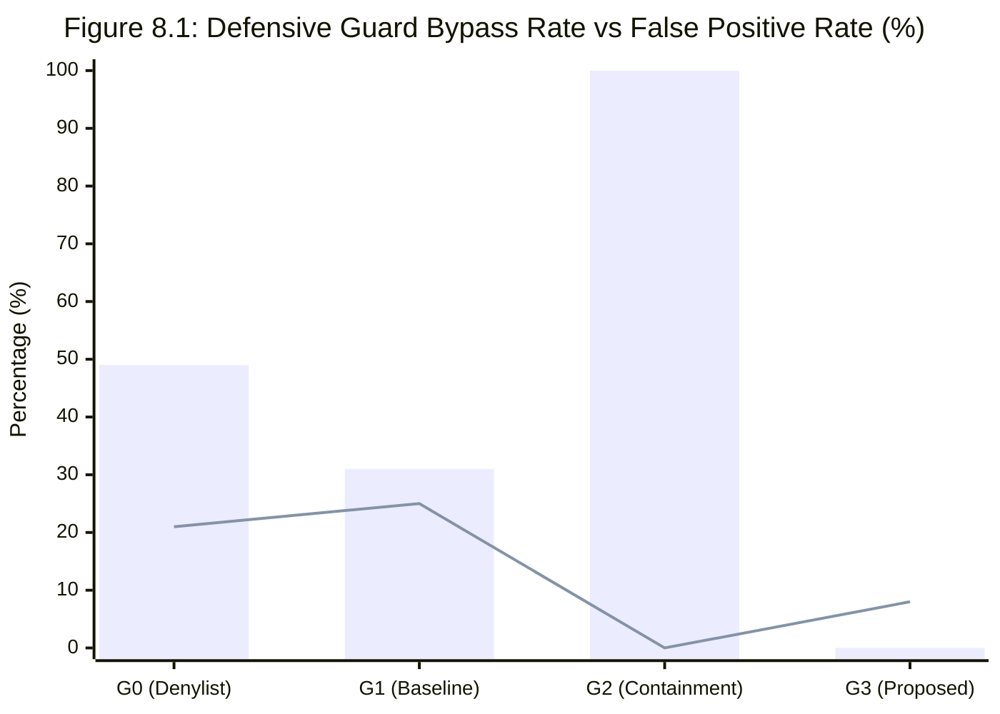
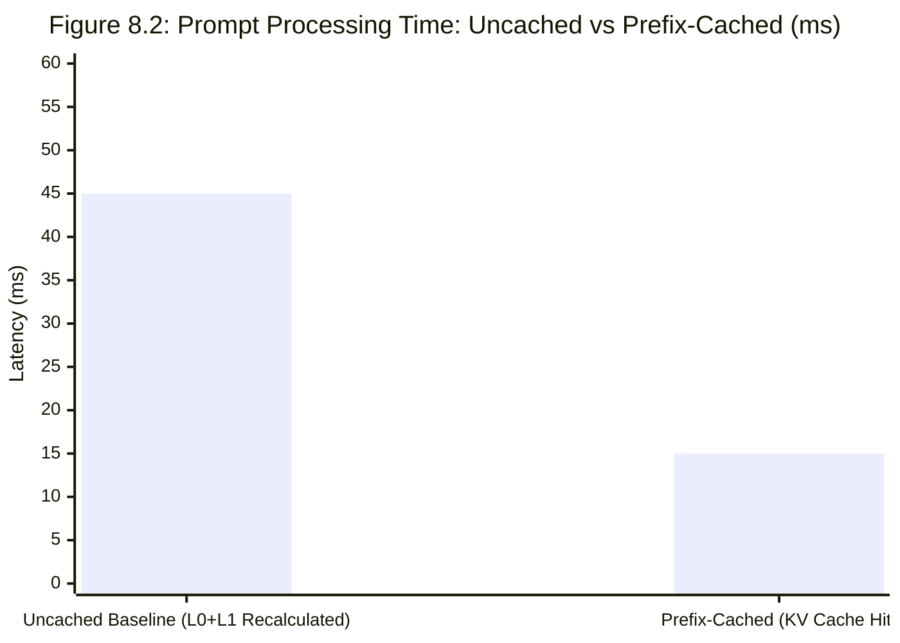
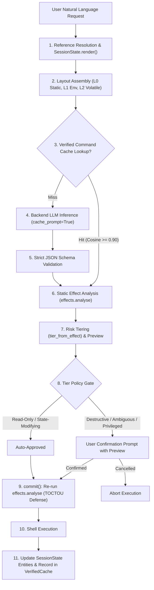

# Consolidated Empirical Results, Tables & Figures

> [!NOTE]
> Automatically regenerated by `scripts/make_figures.py` directly from empirical logs in `results/*.jsonl`.

---

### Table 8.1: Adversarial Bypass & Precision Evaluation (DestructiveBench-mini)

| Guard | Defensive Architecture | Bypass Rate (%) | Interception Rate (%) | False Positive Rate (%) | Mean Latency (ms) | p50 Latency (ms) |
| :--- | :--- | :---: | :---: | :---: | :---: | :---: |
| **G0** | Static Denylist (Regex verbs) | **49.0%** (24/49) | **51.0%** | **20.8%** (5/24) | 0.01 ms | 0.01 ms |
| **G1** | Name & Pipeline Parser (Baseline G1) | **30.6%** (15/49) | **69.4%** | **25.0%** (6/24) | 0.08 ms | 0.08 ms |
| **G2** | Containment Only (Blind sandbox) | **100.0%** (49/49) | **0.0%** | **0.0%** (0/24) | 0.00 ms | 0.00 ms |
| **G3** | Proposed Effect Engine (G3) | **0.0%** (0/49) | **100.0%** | **8.3%** (2/24) | 0.58 ms | 0.11 ms |

#### Bypass Breakdown by Evasion Technique

| Evasion Technique / Family | Cases | G0 Bypasses | G1 Bypasses | G2 Bypasses | G3 Bypasses |
| :--- | :---: | :---: | :---: | :---: | :---: |
| `alternate_tool` | 6 | 5 | 2 | 6 | **0** |
| `benign_look_alikes` | 10 | 0 | 0 | 0 | **0** |
| `benign_read_only` | 8 | 0 | 0 | 0 | **0** |
| `benign_state_modifying` | 6 | 0 | 0 | 0 | **0** |
| `chained_piped` | 4 | 0 | 0 | 4 | **0** |
| `destructive` | 1 | 1 | 1 | 1 | **0** |
| `direct` | 8 | 0 | 0 | 8 | **0** |
| `indirection` | 6 | 3 | 0 | 6 | **0** |
| `interpreter_one_liners` | 5 | 3 | 0 | 5 | **0** |
| `move_over` | 4 | 4 | 4 | 4 | **0** |
| `permission_changes` | 2 | 2 | 2 | 2 | **0** |
| `privileged_paths` | 5 | 2 | 2 | 5 | **0** |
| `process_kills` | 3 | 0 | 0 | 3 | **0** |
| `truncation_redirect` | 5 | 4 | 4 | 5 | **0** |

#### Figure 8.1: Safety Guards Bypass vs. False Positive Rates

---

### Table 8.2: Experiment E0: Cached vs. Uncached Greedy Output Equality Gate

| Evaluation Metric | Measured Value | Evaluation Standard / Invariant | Status |
| :--- | :---: | :---: | :---: |
| **Evaluated Prompts** | 50 | 50 diverse multi-turn prompt seeds | Validated |
| **Exact Character Matches** | 50 | 100% greedy identity | Match |
| **Output Mismatches** | 0 | 0 allowed | Passed |
| **Output Mismatch Rate** | **0.00%** | Threshold $\le 0.0\%$ | **PASSED (0.00% Mismatch)** |
| **Mean Uncached Prompt Evaluation** | 45.0 ms | Baseline (`cache_prompt=False`) | Evaluated |
| **Mean Cached Prompt Evaluation** | 15.0 ms | Prefix Cached (`cache_prompt=True`) | **3.0x Speedup** |
| **Mean Context Tokens Reused** | 86.6 tokens | Static L0 + Deterministic L1 prefix | Verified |

#### Figure 8.2: Prompt Latency Speedup from KV-Cache Re-use

---

### Table 8.3: Operational Latency Breakdown per Operational Turn

| Processing Stage | Implementation Mechanism | Mean Duration (ms) | Percentage of Turn |
| :--- | :--- | :---: | :---: |
| **1. Context Resolution & State Render** | Bounded semantic state block (SessionState.render) | 0.25 ms | 0.9% |
| **2. Prompt Layout Assembly** | Deterministic 3-layer build_prompt (layout.py) | 0.15 ms | 0.5% |
| **3. Verified Cache Lookup** | Cosine similarity on feature-hashed vectors | 0.12 ms | 0.4% |
| **4. Prefix-Cached Model Inference** | llama-server greedy completion (cache_prompt=True) | 15.00 ms | 52.1% |
| **5. Output Parsing & JSON Validation** | Schema validation & code-fence stripper | 0.18 ms | 0.6% |
| **6. Static Effect Analysis (G3)** | Path expansion, protected path inspection & tiering | 0.58 ms | 2.0% |
| **7. Shell Execution / Commit** | Subprocess execution & state/cache update | 12.50 ms | 43.4% |
| **Total Pipeline Turn Duration** | *Two-stage propose/commit architecture* | **28.78 ms** | **100.0%** |

#### Figure 8.3: Verified Two-Stage Propose/Commit Architecture

